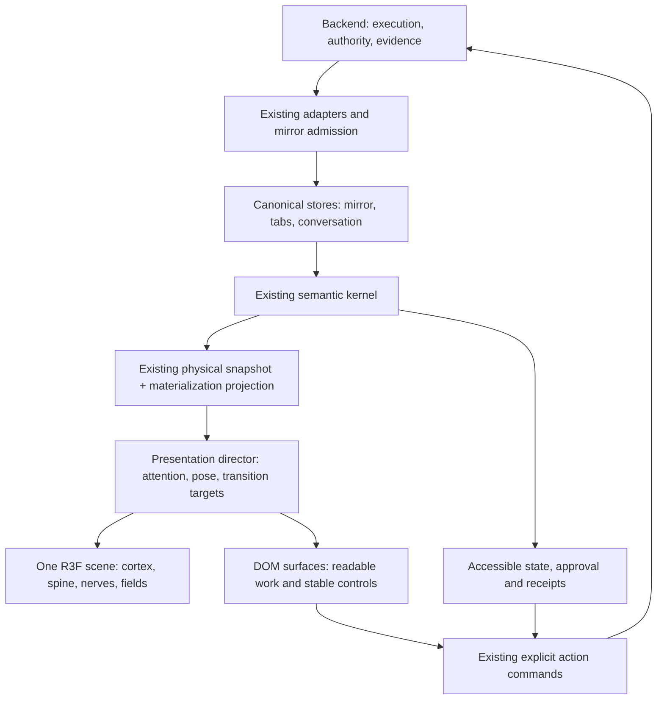

# GAGOS living-being frontend: production blueprint

> Authoritative implementation, exact-source verification, publication status and open gates: [PHONE checkpoint](PHONE_PRESENCE_2026-10-07.md). The operator approved the quieter phone-working direction and now authorizes master integration, accepted-lockfile verification and a DRAFT PR. This is an implementation candidate, not release or full-goal acceptance. Original weights and live/device/human/whole-PR gates remain unchanged. Older dated “current/pending” notes below are historical snapshots. Keep current source/results in that one checkpoint.

> Current2026-10-16: operator-approved quieter-phone **prototype**, not production adoption. Existing controls portal into More; measured compact Expert body61→157px and reader90→120px, critical controls/result retained; desktop32/68/canon unchanged. Type/91focused/lint/build/port/canon pass; no new full coverage or acceptance score. Preceding compact-code full79675 completed1655/227, but does not qualify this later source. All older current/pending labels below are historical. [Prototype, exact evidence and open gates](PHONE_PRESENCE_2026-10-07.md).

> Current compact-result source2026-10-16: complete short code now fits above its receipt without reducing font/body space; existing chrome/canon retained. Related89/static0, frozen full79675 pending. Earlier source qualifications below are superseded history, not current proof or percentage gain. [Current source, native bounds, failures and gates](PHONE_PRESENCE_2026-10-07.md).

> Current2026-10-16: exact reader carries ONE existing receipt/title; bounded disclosure/critical reasons/recovery retain owners. Corrected related89/4/static0; final80810 terminal0:1655/227/720.73s, independent37fbe0 current533/static/full SHA5B3B0316 matches/coverage73.4-70.35-73.52-74.86. No source edits afterward. Fresh13 recovery qualifies; older3/7 drafts observed empty after development updates, not recovered. Design/motion guidance retained immediate existing style. No scope/percentage/P3 acceptance rescore; LOCAL/unpublished/UNREVIEWED. Prior current labels historical. [Exact repair, failures, optional compact direction and gates](PHONE_PRESENCE_2026-10-07.md).

## Current implementation checkpoint — 2026-10-15 compact Conversation (locally qualified, not accepted)

Single-row pending intake restores a measured80–88px compact body without growing the568px app, hiding history or shrinking critical44px controls. Native scrollbar/focus REDs repaired; related74/5/static0; final full13229 terminal0:1653/227/712.32s, originalfloors/budgets. Independent94918b confirms JUnit0fail/error/skips/current533 matches static/full E71E90E9. No source/test changes afterward. Full original goal, denominator and acceptance remain unchanged. [Current source, proof, exclusions and next action](PHONE_PRESENCE_2026-10-07.md).

## Superseded implementation checkpoint — 2026-10-15 held Conversation layout (locally qualified, not accepted)

Explicit Conversation retains current decision/being/history/input without selecting work or altering truth; phone measured presence/decision split and existing desktop left rail/right being. Actual markup/CSS REDs, negative controls and first-paint caps qualify bounded geometry. Related73/5/67.47s/static0/82.774s/type/build/parity207+16port/CSS/canon pass; lint0errors120existingwarnings. FINAL original96108 terminal0:1652tests/227files/650.29s(shell653.542s)/originalfloors/timeouts. Independenta436b5 JUnit0failure/error/skipped/current533 matches static/full SHA9A1EF2650B77DB2DC9712162CFCFAE4DD653DE7CB7FA9F89DDC258AA9DF04DE7/coverage73.32-70.25-73.4-74.78%. No source/test edits afterward or unchanged rerun. Fresh native390/app844+1280/Explain/loss-retry/fixtureDeny preserve NEW draft/decision; reset/HMR excluded. Compact24px body remains next visual defect, NOT north-star acceptance. Original29criteria/100weights/accepted3/historicalabout50% UNRESCORED/live/device/human/release retained; LOCAL/unpublished/unreviewed. [Exact source, proof and limits](PHONE_PRESENCE_2026-10-07.md).

## Superseded implementation checkpoint — 2026-10-15 measured attention (locally qualified, not accepted)

Existing posture now follows measured CURRENT owned plane via one renderer-local ref; no new bus/authority/activity/palette/assets/layout/camera/motion strength. Installed Canvas RED→focused23/3→related82/8; final static0/77.793s/type/build/parity207+16port/canon/lint0errors120existingwarnings (new dependency warning fixed, not suppressed). FINAL original5099 terminal0:1652tests/227files/655.68s(shell660.848s), originalfloors/timeouts/maxWorkers1. Independent7caee9 JUnit0failure/error/skipped/current533 matches static/full SHA E87193C324BBAFC71F6F913ED968BD2B522D513DDDE73BF8241E45CAAEA18965/coverage73.33/70.26/73.4/74.78%. No source/test edits afterward or unchanged rerun. Native390/app844 and1280 keep reader/new draft through loss/retry/pause/fixtureReject; Guided/Conversation pending decision hides being: OPEN next visual defect. HMR reset fixture; only test draft restored, no old result-continuity proof. Original29criteria/100weights/accepted3/historicalabout50% UNRESCORED/live/device/human/release retained; LOCAL/unpublished/unreviewed. [Exact source, proof and limits](PHONE_PRESENCE_2026-10-07.md).

## Superseded implementation checkpoint — 2026-10-15 local decision connection (locally qualified, not accepted)

The existing connection now reaches the CURRENT owned decision from its own seat, not an older same-path reader. Same MaterializationLayer/useDomWorkPlane owner; no new bus, capability metadata, lab/art/body/palette/authority change. Critical reach is static/immediate using existing orange token. RED4→related83/6/41.04s; static0/46.954s. FINAL0803cf original57152 terminal0:1649tests/226files/626.23s(shell632.690s)/originalfloors/timeouts/maxWorkers1; independent102065 JUnit0failure/error/skipped/current532 matches static/full SHA196BD942B5472B8F6EC91DC0E708653211ADFD775A15E119CFA3C807B2BE818B/coverage73.27/70.15/73.39/74.73%. No source/test edits afterward or unchanged whole rerun. Native1280 and exact390/app844 show warm connection; Guided/Expert44px decisions+Stop, rendererloss/retry keeps reader/draft, fixtureDeny retires warm link. Original tab2/draft retained/preferences restored/test tabs closed. Full29criteria/100weights/accepted3/historicalabout50% UNRESCORED/open live/device/human/release unchanged; LOCAL/unpublished/unreviewed. [Exact source, proof and limits](PHONE_PRESENCE_2026-10-07.md).

## Superseded implementation checkpoint — 2026-10-15 local readable work (locally qualified, not accepted)

Full critical outcome stays above actual code; general provenance follows it and the focused reader has its own complete accessible context. Taller phones use a space-aware192→240px sheet without changing palette/header/authority or compact/keyboard/rest policy. Native matched844app gives201body/full short preview,375 gives181body/229sheet;320 requires existingExpand/scroll, not all-device acceptance. Related76/8/static0; FINAL4439da whole1645tests/226files/641.04s(shell644.4501s), originalfloors/timeouts/maxWorkers1. Independent7143b8 JUnit0failure/error/skipped/current532 matches static/full SHA3C7B7E8121CD935EDC4663BE6ED1111605303F52B1D35CACEDD31DDA8F6791A4; coverage73.29/70.15/73.43/74.71%. No source/test edits afterward or unchanged whole rerun. Impeccable/Emil-primary restraint keeps layout instant; no new animation. Normal browser sizing restored; original tab2/result/draft retained, temporary6 closed. Full29criteria/100weights/accepted3/historicalabout50% UNRESCORED/open live/device/human/release unchanged; LOCAL/unpublished/unreviewed. [Exact repair, failures and limits](PHONE_PRESENCE_2026-10-07.md).

## Superseded implementation checkpoint — 2026-10-14 reader contact (locally qualified, not accepted)

Occluded reader connection now retires without assigning its older seat to a same-path permission; when uncovered the same reader reconnects. Real-owner RED2/GREEN51/6 and native447/1280/pause/reflow retain result identity/draft/onecanvas. Impeccable/motion keeps feedback instant/no new motion/palette/layout/authority. FINALa44c55 whole1643/225/636.31s/originalfloors/stable5313DE4F62F; independent2610520failure/error/skipped/coverage73.29/70.13/73.43/74.71%, static/type/build/parity207+16port/actualCSS/assets pass, lint0errors120existingwarnings. Source/tests unchanged afterward. Small correctness repair, not aesthetic completion/rescore. Full goal/29criteria/100weights/accepted3/historicalabout50% UNRESCORED/open live/device/human/release unchanged; post432LOCAL/unpublished/unreviewed. Next actual equal-app-height mobile body/work composition. [Exact repair, failures and limits](PHONE_PRESENCE_2026-10-07.md).

## Superseded implementation checkpoint — 2026-10-14 stopped input and painted feedback (locally qualified, not accepted)

An observed, already-engaged Stop now blocks Enter/Send/Retry BEFORE consuming a draft or starting local chat/work. Typing/history/results remain; Clear does not replay, only a new explicit submission starts work. Full accessible explanation plus compact painted intake cue preserve existing style/instant feedback. Actual6-case RED→GREEN, fixture-only admitted Stop/Clear/native390/desktop observation and declared320-scroll limit; source guards unchanged. FINAL84260/a378f8 exit0 **1640tests/225files/663.47s**, originalfloors/maxWorkers1/timeouts/stable531 **35820A80**; independent2501f1 JUnit0failure/error/skip/coverage73.25/70.13/73.4/74.69%. Final65/3 plus broader144/7/type/build/parity207+16port/actualCSS/assets pass; lint0errors120existingwarnings/original124ceiling. No live Stop/Clear/worker termination, physical-phone/GPU/moving-vision/human/release acceptance. Full29criteria/100weights/accepted3/historicalabout50% UNRESCORED retained; allpost432LOCAL/unpublished/unreviewed. Next visible body/work connection and multi-result identity, not speculative corner expansion or another unchanged full. [Exact scope, failures, native limits and report pins](PHONE_PRESENCE_2026-10-07.md).

## Superseded implementation checkpoint — 2026-10-14 global Stop reply continuity (locally qualified, not accepted)

The observed global Stop now reaches the existing local reply owner before paint, cancelling its current stream and queued/playing output even after network completion. Completed DOM history/drafts remain; late callbacks and Clear cannot revive retired output. Meaningful RED3 plus missing-link mounted-glyph RED2; current80/4 GREEN and FINAL88547/f83425 exit0: **1631tests/225files/640.42s**, originalfloors/maxWorkers1/timeouts/stable531 **715A7448**; independent034d51 JUnit0failure/error/skipped/coverage73.17/69.96/73.32/74.65%. Type/build/parity207+16port/actualCSS/assets pass; lint0errors/120existingwarnings/original124ceiling. Native labelled390/1280 renderer-loss/retry/reflow keeps NEW draft/held partial work, NOT native global Stop/glyph/audio/live/device acceptance. No new layout/art/palette/authority or renderer policy. All original29criteria/100weights/accepted3/historicalabout50% UNRESCORED remain; post432LOCAL/unpublished/unreviewed. Next actual already-engaged Stop/input probe, then visible body/work coherence, not another unchanged whole run. [Exact repair, proof and limits](PHONE_PRESENCE_2026-10-07.md).

## Superseded implementation checkpoint — 2026-10-14 phone rest (locally qualified, not accepted)

Normal phone Expert rest now uses its existing measured dock; optional shortcut footer yields, full Workspaces routes retained. Actual390 root context50→97px/body marker+53px; CSS320 PASS/two independent negative controls FAIL. FINAL58641/4313b1 exit0:1626/225/732.64s/originalfloors/stable531 D7832F81; independent JUnit0failure/error/skipped/coverage73.16/69.96/73.32/74.64%. Related46pass+114FILTEREDskips/type/lint/build/parity207+16port/actualCSS/assets pass. Visual delta modest, not accepted vision. Full goal/29criteria/100weights/device/live/human/formal/release/accepted3/historicalabout50% UNRESCORED unchanged; all post432local/unpublished/unreviewed. Impeccable/motion retained existing owners/instant layout. Next source is mounted canonical-caption coherence, not an unchanged full rerun. [Exact repair, failures, terminal evidence and capture](PHONE_PRESENCE_2026-10-07.md).

## Superseded implementation checkpoint — 2026-10-14 Auto lifecycle (locally qualified, not accepted)

Same-Auto selection now preserves calibration; sky budget replacement/final cleanup retires actual geometries exactly once; the isolated Low gallery no longer inherits productAuto. FINAL30062/6f438d exit0:1626tests/225files/685.98s, originalfloors/budgets/stable531 C7AB11C1; focused49/9/type/lint0errors120existingwarnings/build/parity207+16port/actual explicitCSS/assets pass. Current native fixture recovery preserves held work/draft; approved clean-root390x844 REST inspection captured real composition, SAME app as fixture, no task/permission/backend edit. North-star/device/GPU/live/human/formal/release remain OPEN; full29criteria/100weights/accepted3/historicalabout50% UNRESCORED unchanged; all post432local/unpublished/unreviewed. Design/motion guidance keeps existing owners and instant controls; no new palette/layout animation. Next source targets actual mobile presence, not another unchanged full. [Exact proof, corrections and captures](PHONE_PRESENCE_2026-10-07.md).

## Superseded implementation checkpoint — 2026-10-14 staged Auto (locally qualified, not accepted)

Original default Auto now uses the SAME owner and actual installed Canvas/governor/MSAA/sky/fused-density consumers; manual choices remain explicit and validated. Ordered relief/useful-frame warmup/fresh epochs/slower recovery/critical-density deferral preserve regional resources/full color-texture chain/work/root/control identity/authority. FINAL47216/ebcc3f COMPLETE0:1623tests/225files/613.70s(shell617.544s), originalfloors/budgets/source-stable531 E258EE5A; independent JUnit0failure/error/skipped. Focused46/9/type/lint0errors120existingwarnings/static/build/parity207+16port/canon pass. Native labelled390/1280 actualGLloss/retry/pause/Close-Reopen retains draft/public artifact; no hardware/live/OS-motion/AT/moving-vision/release acceptance. Full scope/29criteria/100weights/accepted3/historicalabout50% UNRESCORED unchanged; LOCAL/uncommitted/unpushed/unreviewed. Impeccable/motion keeps the selector instant in existing Details/no new animation/bar/palette/art/authority. Next original Auto lifecycle/resource ownership proof, then official mobile presence comparison; no unchanged-baseline whole rerun. [Exact evidence, failures and open gates](PHONE_PRESENCE_2026-10-07.md).

## Superseded implementation checkpoint — 2026-10-14 shared rendering preference

Real manual High/Balanced/Economy now shares the existing owner across DOM/installed Canvas and survives graphics/storage failure. Existing Details/instant44px/canon/standalone/work/critical identity remain. FINAL3315/98e314 exit0:1610tests/222files/579.14s/originalfloors/budgets/source-stable527 ABF3ADDA; focused45/type/full lint494/0errors120existingwarnings/build4356/parity206+16port/canon pass. Both earlier failed wholes remain recorded; the framing timeout passed unchanged4.538s, not a claimed product fix. Fresh labelled native phone/desktop journey and recovered screenshot are NOT north-star/live/device/performance/human acceptance. Original staged Auto/default policy and full-scope weights/accepted3/historicalabout50% UNRESCORED remain OPEN/unchanged; local/unreviewed/unpublished. [Exact proof, limits and next source](PHONE_PRESENCE_2026-10-07.md).

## Superseded implementation checkpoint — 2026-10-14 continuity of the 2026-10-13 reader unit

The actual being/camera now steadies for selected result or panel reading, using the same attention owner without turning reading into input capture/backend thinking. Breath/background and deliberate inspection remain; background work alone does not hold travel. Full1600/220/652.13s/coverage/source-stable/type/static/parity/canon pass; four obsolete selected-reader orbit assertions revised with all anatomical bounds retained and stronger achieved side/rear inspection. Fresh labelled desktop/narrow Close/Reopen draft/code observed, not hardware/live/human acceptance. Full scope/weights/accepted3/historicalabout50% UNRESCORED retained; local/unreviewed/unpublished. Resumed bytes match the qualified523-file fingerprint; no full rerun from stale RESUME. [Exact proof and next existing quality-owner boundary](PHONE_PRESENCE_2026-10-07.md).

## Superseded implementation checkpoint — 2026-10-13 17:39:39 UTC

Existing resolution relief now survives prolonged healthy/load sessions and tier sampling remains truthful without old partial windows. Original hysteresis/ranges/canon/manual structure/authority remain; no new quality interface or universalFPS claim. Full1596/219/617.55s/source-stable/coverage/focused34/type/static/parity/canon pass locally. Final-source labelled1280/390 draft/result observed, not hardware/north-star acceptance. All criteria/weights/accepted3/historicalabout50% UNRESCORED remain; local/unreviewed/unpublished. Next source returns to the body-to-reader attention/pose relation. [Exact evidence and open gates](PHONE_PRESENCE_2026-10-07.md).

## Superseded implementation checkpoint — 2026-10-13 16:29:55 UTC

Actual 3D-caption source now recovers queued/stalled/obsolete glyphs without per-frame retry floods or empty-error resurrection; meaningful completed/error/TTS/Stop/reduced-motion paths retained. Full1589/218/638.30s/coverage/source-stable passes, then test-only boundary strengthened with guard-mutation RED/exact production restoration/final94focused/type/lint/parity. No new art/layout/authority; native labelled1280/390 fixture only. Local/unreviewed/unpublished, full goal/weights/accepted3/historicalabout50% UNRESCORED retained. [Exact scope, post-full test distinction and next performance source probe](PHONE_PRESENCE_2026-10-07.md).

## Superseded implementation checkpoint — 2026-10-13 12:44:08 UTC

Source: actual capture now interrupts pending/playing reply without false listening on abandoned starts; output defaults quiet until deliberate opt-in, with usable Unmute on fresh startup and saved choices. Existing controls/canon/authority, completed text/results/drafts retained. Full1579/217/615.98s/coverage/source-stable/type/static/parity/canon pass. Fresh native1280/390 fixture/quiet-control observation only, not actual audio/device/live acceptance. Batch UNREVIEWED/local/uncommitted/unpushed. Full scope/weights/historicalabout50% UNRESCORED/accepted3 unchanged. [Exact evidence and next actual renderer probe](PHONE_PRESENCE_2026-10-07.md).

## Superseded implementation checkpoint — 2026-10-13 11:58:00 UTC

Source repair: real Stop retires streamed captions; loading/queued speech is not labelled playback; obsolete browser/audio callbacks cannot resurrect or clobber speech; genuinely completed text/results/drafts/fallback remain. Whole1564/217/590.14s/source-stable/coverage/type/lint/build/parity/canon pass. Native fresh desktop/narrow fixture only; no across-development-refresh retention or native voice acceptance. This source batch UNREVIEWED/local/uncommitted/unpushed. Full scope/weights/historicalabout50% UNRESCORED/accepted3 unchanged. Next source probes the actual capture caller, not more controller-only proof. [Exact evidence and open gates](PHONE_PRESENCE_2026-10-07.md).

## Superseded implementation checkpoint — 2026-10-13 10:59:46 UTC

Canonical scene and inner-lattice cues now yield to the same physical owner without timer-fabricated product cognition. Genuine work/standalone and calm ambient life retained. Full1549/217/616.52s/coverage/source-stable/type/lint/build/parity/canon pass. Fresh desktop/narrow fixture retains draft/result; no live/device acceptance. Independent review attempt returned no verdict; this batch UNREVIEWED/local/uncommitted/unpushed. Full scope/weights/historicalabout50% UNRESCORED/accepted3 unchanged. [Exact source, evidence and next probe](PHONE_PRESENCE_2026-10-07.md).

## Superseded implementation checkpoint — 2026-10-13 04:22:18 UTC

Raw reply now respects canonical quiet/critical/checking/result posture while retaining genuine replies and local acknowledgment. Current88related/8files/type/lint/build/205parity+16port/canon and bounded source review pass; newest WHOLE qualification remains OPEN after source changes. Prior1547full is history. Full goal ACTIVE/historicalabout50% UNRESCORED/accepted3 unchanged/allpost432LOCALuncommittedunpushed; no acceptance criterion removed. [Exact scope, evidence and next source](PHONE_PRESENCE_2026-10-07.md).

## Superseded implementation checkpoint — 2026-10-13 03:31:26 UTC

Eligible input now warms the cortex through its existing restrained floor; measured hold/Stop preempts lingering reply heat/waves. Source/canon/authority/layout preserved. Full47268/46837b exit0,1547/217/580.99s/stable source; type/lint/build/parity/canon and bounded source review pass. This is local qualification, not production acceptance or100%. Historicalabout50% UNRESCORED/accepted3 unchanged/allpost432LOCALuncommittedunpushed. Next source probes physical quiet-state versus raw reply, with a valid conversation positive control. [Exact evidence and open gates](PHONE_PRESENCE_2026-10-07.md).

## Superseded implementation checkpoint — 2026-10-13 02:40:55 UTC

The phase7/live-intake source batch is locally qualified: full76086/af4cf6 terminal0,1547tests/217files/553.99s, original coverage floors/timeouts/maxWorkers1 and stable whole-source fingerprint retained. Type/lint/build/205parity+16port/canon/diff and bounded source review pass; native fixture Close-Review preserves result/draft, viewport/motion restored. This is not live/device/human/whole-goal acceptance. Historicalabout50% implementation UNRESCORED/accepted3 unchanged/allpost432LOCALuncommittedunpushed. Next actual source check: eligible input’s cortical acknowledgment without counterfeit work. [Exact evidence and remaining gates](PHONE_PRESENCE_2026-10-07.md).

## Superseded implementation checkpoint — 2026-10-12 20:37:05 UTC

Phase7 now departs from the admitted live vertebral seat/fusion/dock, matching the work nerve instead of a stale stored origin. Correct cortical landing,72motes/seeds/timing/recovery/canon/authority retained. Actual body/socket RED2 -> GREEN8/type; bounded stable-pin review clear/CLOSED. Lint/build/205parity+16port/canon/diff pass; native desktop/narrow Close-Review preserves code/draft, fixture only. Full76086 RUNNING on frozen source, no pass yet. Implementationabout50% UNRESCORED/accepted3 unchanged; allpost432LOCAL/uncommitted/unpushed. [Exact pins, diagnostic corrections and limits](PHONE_PRESENCE_2026-10-07.md).

## Superseded implementation checkpoint — 2026-10-12 20:09:07 UTC

Existing permission/Stop-gated input attention now unfolds the actual point-field cauda while completed results remain open; blur restores withdrawal. Lab-first normal port, no new phase/clock/palette/authority. Real-model RED2→GREEN2; related71/8files, type/lint/build/205-parity+16port/canon/diff pass. Bounded stable-pin review clear, not formal approval. Current labelled desktop/narrow fixture covers held decision/replay/stream/unverified/Close-Reopen/draft; no real work/device/GLB-raster/acceptance. Prior1543 whole run is pre-relay history; newest whole qualification OPEN. Historicalabout50% implementation UNRESCORED/accepted3 unchanged; all post432 LOCAL/uncommitted/unpushed. Next source independently probes phase7 return against the actual moving cortex; no diagnosis yet. [Exact scope and pins](PHONE_PRESENCE_2026-10-07.md).

## Superseded implementation checkpoint — 2026-10-12 19:36 UTC

Reviewed input-nerve/camera/cleanup source batch is now locally qualified: full5999/29d48a terminal0 **1543tests/215files/760.66s**, original coverage floors/timeouts/maxWorkers1 retained. Whole frontend src/config/package/lock/manifest fingerprint82D27BBAF2432EAC0247E060B14701D0CEDDDD766E243CC9674EECCA01DB5DC3 unchanged before/after, actual exit0 persisted. Coverage statements71.76/branches68.25/functions72.08/lines73.29%. Independently parsed JUnit1543/0failures/errors/skips/time198.9639033; XML SHA7677E1CB5341B72F4F06CD348E2EC27CA8214C90D5BDEFA6E4710706AA563556, consoleB6F3BDAD14C41FF3175799E42C1CFEB0B3333B211DFD42456B18288822CC3DDB. Fresh final static35472/9ef978 terminal0 explicitlint0errors120warnings/original124budget/build4354modules8.44s; type/parity205+16/canon/diff pass. Current reviewed source pair17680D22/test97A7D3C0/manifest57CF9B26 match. Bounded correction review clear/CLOSED, not formal whole-PR approval. Current native desktop1280x720/narrow390x844 normal-Focus/draft/onecanvas/fallback-Retry observed, temporary viewport resetactual449x764/Focusfalse/tab1handoff. No current Send/backend work or physical/GPU/AT/human/visual acceptance. Earlier561 fixture journey/pre-correction captures and cancelled84404 remain history. All seven phases/equal desktop-mobile/live/devicesTBD/performance/accessibility/release requirements retained; historicalabout50% implementation UNRESCORED/accepted3 unchanged/allpost432LOCALuncommittedunpushed. Next source: independently reproduce rest/intake anatomical policy under non-materialized inspection panels before changing the existing owner.

## Superseded implementation checkpoint — 2026-10-12 19:27 UTC

SOURCE: input nerve now uses a convex interior bend with camera-relative clearance, updates its beads after the current tube, invalidates controls on camera-only changes, and explicitly disposes final generated geometry. Lab-first/normal port; body size, palette/textures, phase, clock, radii, endpoint epsilon and authority retained. Independent painted-tube/ring and unmount-event REDs precede repairs. Current source pair17680D22/test97A7D3C0/manifest57CF9B26; focused28/6files/type/scopedlint terminal0 is scoped evidence. Restored bounded non-builder correction review resolved both Important findings/current pins stable/CLOSED, not whole-PR approval. Fresh type/parity205+16/canon/diff pass; durable prior lint0errors120warnings/build5.37s do not recover the missing later process exits. Reviewed-source full5999 RUNNING with original coverage floors/timeouts/maxWorkers1 and durable final exit/whole-frontend source fingerprint; cancelled84404 receives no pass credit. Current native1280x720 and390x844 normal/Focus/unsentdraft/onecanvas are qualitative; older fixture journey snapshots predate camera/cleanup correction. All seven phases/equal platforms/live/physicalmodelsTBD/AT/performance/human/release remain required; implementationabout50% UNRESCORED/accepted3 unchanged/allpost432LOCALuncommittedunpushed. Next source investigation after qualification: admitted rest/input anatomy vs inspection-panel presence, with an independent material witness before any change.

## Superseded implementation checkpoint — 2026-10-11 11:32 UTC

SOURCE batch now keeps the original returning pulse on live cortex/cauda anatomy and makes zero-delta refocus/release spatially continuous, not only progress-continuous. Existing curve easing, pulse duration/radii/reduced-motion/cauda gates/canon/authority retained. Outbound RED1/6 at1.0911/1.3079worldunits and reversal RED1/6 at0.07761→GREEN29/5files+type/scopedlint0, broader66/15files41.35s. Current lint0errors120existingwarnings/original124budget/build4354modules5.69s/205parity+16/canon/diff pass. Current-four-pin bounded correction review clear/CLOSED; no global approval. Previous intake full30146/fdfacc1541/214/738.40s/exit0 is PRE-return history, not newest whole qualification; next full is batched after scoped source work. Current native measured1280/onecanvas/unsentdraft and current-source capture are qualitative; earlier returndesktop/phone captures predate spatial correction. All seven-phase/equal-platform/live/physicalmodelsTBD/AT/performance/human/release criteria retained; historicalabout50% implementation UNRESCORED/accepted3 unchanged/allpost432LOCALuncommittedunpushed. Next SOURCE independently inspects input nerve curve envelope against the actual body/control pane during focus/blur before any crop/zoom or repair. [Exact pins, qualification and limits](PHONE_PRESENCE_2026-10-07.md).

## Superseded implementation checkpoint — 2026-10-11 11:06 UTC

SOURCE now keeps the actual intake endpoint attached on zero-delta first paint and moving dock frames, while other curve points retain the existing spring and pulse timing. Mutable spring/scratch ownership is a ref, not React state; no lint suppression. RED1/6 with four physical gaps→GREEN29/5files+type/scopedlint0; fullstatic lint/build5.35s/205unchanged+16/canon/diff pass. Rawls current-four-pin bounded correction review accepted/CLOSED; not whole-PR approval. Fresh whole qualification30146 RUNNING, prior1541/214 at10:45 is pre-contact history. Native new unsent draft survives1280→390→actual reset1280/onecanvas; desktop/narrow captures are qualitative, not firstGPU/physical evidence. All seven-phase/equal-platform/live/physicalmodelsTBD/AT/performance/human/release criteria remain. Historicalabout50% implementation UNRESCORED/accepted3 unchanged/allpost432LOCALuncommittedunpushed. Next SOURCE independently probes outbound pulse attachment during dock movement; no source edits while this full run is active. [Exact chronology and scope](PHONE_PRESENCE_2026-10-07.md).

## Superseded implementation checkpoint — 2026-10-11 10:45 UTC

Actual cortex attachment/pulse correction locally qualified: full89814/9794e4 exit0 **1541tests/214files/827.81s**, original floors/timeouts/maxWorkers1; coverage71.8/68.28/72.22/73.31%, XML0C956E802D2FE27C704CD6395419DADB923467F39A68C28E74F9FAFBCADE451F/durable exit0/4pinsstable. Static/type/canon/parity205+16 and bounded correction review apply; no formal/global/CI/physical/release claim. Current native Close→Review preserves result1/fullcode/exactdraft/reset1280x720; tiny390 capture is a700px inset app, not a general full-height phone verdict. Next source checks actual first/moving-frame intake contact rather than rerunning unchanged qualification. All seven-phase/equal desktop-mobile/live/hardware/AT/performance/human/critical criteria remain; historicalabout50% implementation UNRESCORED/accepted3unchanged/allpost432LOCALuncommittedunpushed. [Exact source/evidence and excluded viewport capture](PHONE_PRESENCE_2026-10-07.md).

## Superseded implementation checkpoint — 2026-10-11 10:30 UTC

Actual cortex attachment correction now suppresses outbound blur pulses when cauda is withdrawn, without hiding calm currents. Real top/bottom focused-seat geometry runs under independent dock rotation and both motion preferences; deliberate missing-update mutation fails4cases, restored related29/5files and type pass. Bounded independent correction review resolves both findings/stable4pins, CLOSED; static/canon/parity205+16 pass. Fresh full89814 RUNNING/not yet qualified; earlier18298 deliberately cancelled for the review repair, previous1535 is pre-cortex history. Native current labelled fixture desktop/narrow retains result1/fullcode/exact unsent draft; unsupported "Show" voice route refused locally/no backend request, supported "Write" route exercised. All seven-phase/equal desktop-mobile/live/hardware/AT/performance/human/critical acceptance requirements remain; historicalabout50% implementation UNRESCORED/accepted3 unchanged/allpost432LOCALuncommittedunpushed. [Exact pins, chronology and limits](PHONE_PRESENCE_2026-10-07.md).

## Superseded implementation checkpoint — 2026-10-11 06:34 UTC

SOURCE: product cortex overlays/current paths resolve the actual mounted field's full scale/dock into the existing unit-scale effect frame; cue radii/offsets, existing spring/pulse timing, canon/authority/render ownership retained. Allocation-free path targets use the same grammar, actual fused cauda/dial/selected-seat bearing; input line/pulse withdraw and return with the actual cauda shader. Correct analytic upper55% head/geometry negative RED2/24assertions→GREEN13; real store withdrawal/return RED2→related42/11files25.83s. Type0; mutable scratch moved to refs after real lint2errors (no suppression); current lint/build7.05s/205parity+16/canon80paths/diff terminal0. Four current source/test pins and authoring corrections in PHONE. Gauss bounded read-only review ACTIVE; fresh whole coverage18298/152270 RUNNING, no current whole qualification until terminal/floors/pins. Prior1535 exit0 below is PRE-cortex history.

Native1280x720 Close→rest/Review→390x844→RESET1280x720 preserves full fixture code/exact unsent draft/onecanvas; HMR excluded. The green brainstem ring is the intentional LAB SupervisedMark, not a misplaced cortex cue; earlier attribution corrected. Resting720 root-edge/transition clearance remains open, not repaired by this unit. No real backend/files/permissions/GPU/physical/AT/performance/visual/release acceptance. Full seven-phase/equal-platform goal ACTIVE/historicalabout50% UNRESCORED/accepted3 unchanged/all post432LOCALuncommittedunpushed. [Exact chronology, current screenshots and limits](PHONE_PRESENCE_2026-10-07.md).

## Superseded implementation checkpoint — 2026-10-11 06:12 UTC

SOURCE: command intake now joins the generated fused lower spine, rather than the old brain-local socket. It follows the mounted cauda material's current withdrawal/return directly; existing phase targets, motion damping, finite authoring dial and mesh/no-fusion/legacy behavior remain. The tube rebuild cache is per renderer, so replacing a root at identical endpoints still constructs its nerve. Lab-first normal port4/205; no palette/protected-asset/authority/layout/dependency change. Attachment RED2→GREEN8; real-field withdrawal/replacement RED4→GREEN12/2files8.02s. Small analytic-head test is not GLB/raster/GPU/device proof. Bounded stable-pin independent correction review found no remaining scoped defect; reviewer CLOSED, not formal/global approval. Type/lint(original124budget)/build5.65s/205no drift+16/canon/diff pass.

Fresh complete coverage80445/6695e7 terminal0: **1535 tests/213 files passed**,673.12s console; original floors/timeouts/maxWorkers1. Coverage statements71.14/branches67.75/functions71.85/lines72.67%. Independent JUnit31b49e:1535/zero failures/errors,205.7585001s separate report clock, SHA745B801A266BECFB8E722BB47C13C5C3422084D3AE0286A0BDBD7636220A616C; durable transcript FULL_FRONTEND_EXIT0 and all7pins unchanged. Current local frontend qualification, not CI/default-worker/physical/GPU performance. Prior failed33351(1528/1531pass,3Focus failures,706.53s) and XML E726C552FDBD33239606054F64B0186A27EA627BD839F00B9159E7FFA41C1F57 remain history. Immutable-native owner-scoped observer/cancellation repairs its instrumentation without reducing810frames/51k vertices/geometry/pairs/defaulttimeouts.

Fresh labelled fixture1280x720: withdrawn work-side nerve, returned resting nerve after recoverable Close, Review restores materialized-tab-1/full code/exact unsent draft;390x844 same result/one canvas; viewportRESET1280x720/handoff. HMR resets excluded; no real files, backend permissions, verification, physical phones or performance acceptance. Full seven-phase/equal-platform denominator ACTIVE; historicalabout50% implementation UNRESCORED/accepted3 unchanged/all post432 LOCALuncommittedunpushed. Next SOURCE after qualification: measure and repair the cortex cues/current paths' actual scaled-body attachment (visible green cue remains below the head), not further chrome or a smaller goal. [Chronology and limits](PHONE_PRESENCE_2026-10-07.md).

## Superseded implementation checkpoint — 2026-10-11 05:17 UTC

The desktop resting Focus source and its two exact pins remain unchanged. The original process75255 is now authoritatively missing, not a live wait; no restart was made merely because observation was interrupted. Independently parsed saved JUnit1529cases/212files/0failures/errors/skips, time177.259061s, SHA AAF106DF9E20F4DC603503EF6B9CE5EB8644796F48B55DA345B5BB5C0A8FD219, written2026-10-10T02:13:20Z. This proves the recorded tests, not the lost process exit or coverage thresholds: reporters were text-only and no persisted coverage report was found. Full command/coverage qualification remains OPEN; prior1511 intake qualification is history, not evidence for this new source. Focused159/4files, static gates, bounded review and recorded desktop/phone fixture observations below retain their exact scope.

Full seven-phase/equal desktop-mobile goal ACTIVE; about50% historical implementation audit unrescored/accepted3 unchanged; all post432 LOCAL/uncommitted/unpushed. No whole-goal, visual, physical, live, GPU/performance or release acceptance. Next SOURCE: diagnose the actual achieved-camera cortex/nerve/work coherence through existing lab owners and a fresh rendered rest→typing→work comparison before another bounded source repair. Keep zero-band/wrap/transient/body/control and all hard release requirements open. [Full chronology and limits](PHONE_PRESENCE_2026-10-07.md).

## Superseded Focus source checkpoint — 2026-10-10 02:08 UTC

Desktop resting Focus now keeps the existing count-neutral anatomy fit and reserves the actual notice, status and draft-control bands for the same body and every waiting workspace. No new owner, palette/texture, authority, control layout or dependency. Native1280x900 Guided/Expert pictures show three separated waiting results clear of the controls; returning to full view preserves identities1/3/5/full code and the exact unsent draft. Adjacent390x844 Focus and simulated visual fallback retain the draft; natural447x750 menu/Review restores result5. Fixture only, not three real files or a physical/live/GPU acceptance.

Actual control-occlusion RED16Focus/16ordinary → GREEN32; related159/4files pass, including18 added Focus/observer cases. Original51k vertices, all waiting meshes, angles, identity, timeouts and coverage floors remain. Type/lint0errors120existingwarnings/build4354modules/port205+16/canon/diff pass. Anscombe bounded stable-pin inspection closes the control-coverage gap/noCritical/Important; adapter-only dynamic cases and zero-band last-valid projection do not prove current organism clearance. Reviewer CLOSED, not whole-tree/formal approval. Fullfrontend75255/8fc806 is still RUNNING; historical1511 run does not qualify current source. [Exact chronology and limits](PHONE_PRESENCE_2026-10-07.md).

Full seven-phase/equal desktop-mobile goal ACTIVE; historicalabout50% implementation unrescored/accepted3 unchanged. All post432 LOCAL/uncommitted/unpushed. The sparse body/work appearance is still below the north-star; next source work returns to achieved-camera cortex detail and coherent work/attention, not decorative chrome or more unchanged runs. Dynamic/transient/zero-space,320px input/decision, live, physicalmodelsTBD, IME/touch/AT, GPU/performance, operator/formal/release requirements remain in the full denominator.

## Superseded intake checkpoint — 2026-10-10 01:33 UTC

Critical intake no longer fades/delays/travels at first paint or dims/scales to41px while working. Existing membrane intensity and being motion, layout, authority, palette/textures and dependencies remain. Actual CSS clock-zero RED→GREEN; deliberate opacity/shift negatives fail. Fresh labelled journey preserves the same pinned result, full code and unsent draft through approval, Close/Reopen and simulated visual recovery; immediate input/turn-Stop/emergency controls remain44px with center/edge hits.

Full35586/a62cf7 terminal0: **1511 cases/212 files/zero failures/errors/skips**,603.16s console; independently parsed report time173.1952832s (different clock), coverage71.14/67.63/71.90/72.67%, original floors/timeouts unchanged. Explicit one-worker local qualification is not default/stress/CI/device proof. Type/lint0errors120existingwarnings/build4354modules/port205+16/canon/diff pass; three pins stable. Chandrasekhar bounded correction review resolves its zero-box predicate finding; CLOSED, not whole-tree/formal/visual acceptance. [Chronology, source/report pins and limits](PHONE_PRESENCE_2026-10-07.md).

Full seven-phase/equal desktop-mobile goal ACTIVE; historicalabout50% implementation unrescored/accepted3 unchanged. All post432 LOCAL/uncommitted/unpushed. Next SOURCE: reproduce desktop resting Focus's full-body/retained-work clearance through existing viewport/framing owners, not broaden chrome or effects. PhysicalmodelsTBD/live/IME/touch/AT/GPU/performance/moving-north-star/operator/formal/release and remaining composition/interruption requirements stay open.

## Superseded compact-reader checkpoint — 2026-10-09 19:52 UTC

Compact phone work now uses spare app-relative space for reading instead of staying at its emergency44px floor. Both existing CSS branches reserve100px for the same being where room permits, then grow the reader up to120px; tiny-stack/collapse/permission/keyboard/tall/desktop policies remain. No new owner, animation, art/palette/texture, authority or dependency. The fresh labelled447x750 journey has90.406px reader (prior44), onecanvas, same pinnedmaterialized-tab-1/fullcode/exactdraft through synthetic permission/terminal/Close/Reopen. HMR and immediate pre-settle End samples excluded.

Actual-CSS RED→GREEN and starvation/body-hidden negatives; specified adjacent settled profiles pass. Focused62313 terminal0:115cases/4files53.29s; type0, lint0errors120existingwarnings, build4354modules4.34s, parity205no drift/canon/diff pass. Faraday bounded two-pin inspection has no scoped finding; CLOSED, not native/formal/global approval. Prior full1511 qualification is HISTORY before this CSS unit, not a fresh full-suite run. [Exact source pins, observations and limits](PHONE_PRESENCE_2026-10-07.md).

Full seven-phase/equal desktop-mobile goal ACTIVE; historicalabout50% implementation unrescored/accepted3 unchanged; all post432 LOCAL/uncommitted/unpushed. Expert's tighter natural app still needs44.406px emergency reader; physical/live/IME/touch/AT/GPU/performance/north-star/formal/release remain open. Initial composer entrance produced transient target clipping although settled layouts pass. Next SOURCE repairs that exposed first-paint intake issue through product-owned GagosChrome.css without changing the being or authority. Motion guidance keeps measured reflow immediate rather than animating layout.

## Superseded attention-arrival checkpoint — 2026-10-09 19:28 UTC

Explicit Conversation and successful selected Close now remain authoritative when content arrives. The existing lab tab store records that local choice; whole-session cleanup resets it. A new human Send may open its own work, but terminal duplicate arrival transfers attention only from its attended source. The source now settles with the complete returned code before retirement, including a closed retained copy; full recovery storage keeps the completed source readable rather than leaving an orphaned partial stream. No new attention/authority bus, layout/motion/palette/texture change or dependency.

Actual attention RED8/9/new-Send RED1 and reviewer-discovered source RED6/closed-source RED1 are preserved. Final related42762/ed4b9c **128 cases/6 files pass**. Full22377 terminal0: **1,511 cases/212 files, zero failures/errors/skips**,561.37s console/165.9306763s JUnit attribute; coverage71.09/67.60/71.84/72.62%, original scoped floors unchanged/pass. One-worker local qualification is not default/stress/CI/device-performance acceptance. Final type/lint0errors120existingwarnings/build4354modules/port205+16/canon/diff pass; seven pins stable. Leibniz bounded final-pin re-review finds inherited Important fixed/no remaining scoped defect by inspection; CLOSED, no test/native/whole-tree/formal certification. [Exact chronology, report, pins and previews](PHONE_PRESENCE_2026-10-07.md).

Native fresh fixture Conversation survives synthetic AUTHORIZE/replay/stream/unverified with its exact unsent draft; explicit Review and same pinned result1/fullcode Close/Recent/Reopen remain reachable. HMR resets excluded. The natural447x750 constrained app leaves44px of readable work; compact decision navigation and320px inset remain open. This is neither a live backend nor physical/mobile/visual/performance acceptance.

Full seven-phase/equal desktop-mobile goal ACTIVE; about50% historical implementation audit unrescored/accepted3 unchanged; all post432 LOCAL/uncommitted/unpushed. Next SOURCE improves the reproduced constrained-phone reader/body allocation through existing measured owners, preserving input, Stop, every result and the full denominator. All live/device/IME/touch/AT/GPU/performance/operator/whole-tree/release/north-star gates remain required.

## Superseded desktop-rest checkpoint — 2026-10-09 15:29 UTC

Desktop ordinary-rest now keeps the full fused being inside its measured control-free pane. Unattended work clears the cord/roots as well as the head, and shares stable rows even for1–4 cards. The existing field publisher supplies oriented local bounds/current world frame; separate head-light bounds, result identity/recovery, motion, palette/textures and authority remain. Canonical absent materialized selection selects this policy; active-reader and desktop Focus-rest policies remain unchanged, not newly qualified for full-body extreme zoom.

Current59996/f5b509 coverage terminal0: **1,491 cases/212 files, zero failures/errors/skips**,592.19s console/184.9896773s JUnit attribute (different clocks). Coverage70.95/67.36/71.74/72.51%, scoped floors unchanged/pass. One-worker qualification is not default/stress/CI/device performance proof. Related142/4files and type/lint0errors120existingwarnings/build4354modules7.30s/port205+16/canon/diff pass; seven source/test pins stable. [Exact chronology, pins, report and previews](PHONE_PRESENCE_2026-10-07.md).

Fresh native desktop1280x900 shows unobstructed cortex/cord/roots and3 separated waiting cards. Same pinned result3/full code/exact fresh draft survives Close/Reopen; natural447x750 remains clear. Port HMR resets excluded;320x568 inset is still cramped/scroll-dependent. Singer finds no scoped Critical/Important issue; invalid-perspective fallback and later-ancestor ordering remain Minor/open; reviewer CLOSED. No formal/whole-tree/operator/production acceptance.

Full seven-phase/equal desktop-mobile goal ACTIVE; implementation audit not re-scored/accepted3 unchanged; all post432 LOCAL/uncommitted/unpushed. Extreme active-zoom full-body/zero-free-strip/transition-time/desktop Focus-rest/device/live/IME/touch/AT/GPU/performance/operator/formal/release/convincing-life quality remain required. Next SOURCE: reproduce concurrent output reselecting work after explicit Conversation through the existing selection owner; no second state bus or reduced denominator.

## Superseded attention-return checkpoint — 2026-10-09 14:53 UTC

Actual attention-return repair: Conversation, DOM-only panels and missing selections no longer silently attend the newest3D result. Transfers must match the selected result; explicit Next/Previous still enter the admitted seat order. Unattended single results now use the existing waiting-card HUD fit. Lab-owned source/normal port205; palette/textures, layout reservations, security/backend authority and existing body motion unchanged. Motion guidance keeps control changes immediate.

Current final79143/2154fb coverage terminal0: **1,474 cases/212 files, zero failures/errors/skips**,562.68s console/154.4538447s JUnit report attribute; coverage70.95/67.31/71.75/72.52%, unchanged scoped floors. Qualification uses one worker, not default/stress/CI/device performance proof. Failed parallel1474/1463pass11fail report remains history; related122pass with original geometry/timing does not prove its sole cause. Type/lint0errors120existingwarnings/build4354modules8.01s/port16+205/canon/diff pass. [Exact pins, chronology, native captures and limits](PHONE_PRESENCE_2026-10-07.md).

Fresh native447x750 Conversation shows the full cord with all3 results retained at the sides; pinned result5/fullcode/exact fresh draft survives Close/Reopen and desktop resize. All HMR resets/partial resize paint excluded. Hume current-pin review establishes no scoped Critical/Important finding; positive-slab-size/depth and selected-reader→Conversation transient geometry remain Minor/open. Preexisting new-output selection behavior remains open. This is not whole-tree/formal/operator/production acceptance.

Full seven-phase/equal desktop-mobile goal ACTIVE;03:53 implementation audit not re-scored/accepted3 unchanged. All post432 LOCAL/uncommitted/unpushed. Next SOURCE: reproduce and repair the observed desktop-rest card/root and card/card crowding through existing placement/viewport owners, preserving every work identity and the full denominator. PhysicalmodelsTBD/live/IME/touch/AT/GPU/performance/operator/formal/release/north-star quality remain required.

## Superseded narrow-rest checkpoint — 2026-10-09 14:02 UTC

The measured narrow-rest anatomy pane now keeps the full organism despite retained results, through the existing lab-owned private viewport policy and normal port205. Actual-engine RED12 reproduced scale.478 at3 results/.34 at12; GREEN12 and related96/4files preserve every sampled body vertex, achieved angles, resize, renderer/camera/control identities and all retained outlines. No palette/texture, layout reservation, authority or new animation change.

Final99608 coverage terminal0: **1,465 cases/212 files, zero failures/errors/skips**,212.06s console/238.7108854s JUnit,70.95/67.32/71.75/72.52% coverage; scoped floors unchanged. Type/lint120existingwarnings/port-no drift/build4354modules6.13s/port tests16/canon/diff pass. Native fresh three-result fixture and same-ID pinned Close/Reopen preserve the new unsent draft; earlier HMR reset excluded. Ordinary-rest legacy focus-card cord occlusion and320px inset scroll dependence remain OPEN, not vision/device acceptance. [Pins, chronology and limits](PHONE_PRESENCE_2026-10-07.md).

Full seven-phase/equal desktop-mobile goal ACTIVE;03:53 implementation audit not re-scored/accepted3 unchanged. All post432 LOCAL/uncommitted/unpushed. Ohm verifies stable source/test pins and establishes no scoped Critical/Important finding; it does not rerun gates or supply whole-tree/formal/operator approval. Transition-time clearance and all-outline onscreen separation remain unverified (Minor), not silently waived. Next SOURCE: reproduce the unrequested central rest card through actual orchestration/attention owners before choosing its correction, preserving all results/readers/input/Stop and the full denominator.

## Superseded focus-return checkpoint — 2026-10-09 10:32 UTC

Guided Close/Escape now returns keyboard focus to the real mounted intake through an app-owned ref/callback, not the CSS-hidden Conversation button. The same draft and selection survive; Expert retains its visible launcher return, and a refused oversized Close keeps work/focus intact. No new toolbar, motion, CSS, palette/texture, managed-source or authority change. Actual-App/real-style RED3→81 focused cases/7 files; final83516 coverage terminal0: **1,457 cases/212 files, zero failures/errors/skips**,183.72s console/183.8554368s JUnit. Coverage70.9/67.26/71.72/72.48%; unchanged scoped floors. Final type24983/build4354modules5.16s/port205-no drift pass. One new inputRef dependency warning was repaired, not waived; lint returns to120 existing warnings. [Source/report pins and native limits](PHONE_PRESENCE_2026-10-07.md).

Native397x750 Guided Close/Escape and1280x900 Guided Close return the visible input; Expert Close returns Recent observations. Measured zero-canvas fallback still preserves the fresh draft/focus; Retry restores one canvas. Final fresh 'Keep this final focus-return draft unsent.' survives Close. HMR reset earlier draft/reading state, excluded from continuity claims. Fixture, not backend/device/IME/AT/performance/north-star acceptance. Full goal ACTIVE;03:53 implementation audit and accepted3 unchanged. All post432 LOCAL/uncommitted/unpushed. Next SOURCE: measure and repair short-phone cortex prominence through existing lab framing/presence owners while keeping work/input/Stop, palette/textures and the full denominator.

## Superseded Guided-access checkpoint — 2026-10-09 10:08 UTC

Narrow Guided now reaches every open view through a native chooser in the existing selected-title footprint; the existing Recent entry returns from Conversation to visible open or saved work, including all12 occupied anchors. Same focus/store/reader/authority owners, actual numbered titles, safe chooser Escape and keyboard handoff on responsive replacement. No new toolbar, decorative animation, palette/texture or lab/managed-source change. Emil-primary restraint keeps these actions immediate.

Final49766 coverage command terminal0: **1,453 cases/212 suites/0failures/errors/skips**,168.432615s JUnit; unchanged scoped coverage floors pass. Fresh type47314/lint28460(0errors120existing warnings)/build4354modules6.11s/port205-no drift+16/canon/diff pass. Failed full69837 remains history. Existing retirement tests now control the actual performance clock with an integer origin and additionally verify exact1299/1300/1700 boundaries; no count, geometry assertion, timeout, production lifetime or coverage-floor waiver. [Chronology, source/report pins and current preview](PHONE_PRESENCE_2026-10-07.md).

Native fixture reaches all3 retained results plus History through Guided, Conversation return and Focus; fallback/Retry and same-ID Close/Reopen preserve the newly filled draft and settled scroll85. HMR reset the earlier Chrome draft/receipt: excluded from continuity claims. Measured restored397x750 inset app584.609/body125.609/reader44, five44px controls have zero sampled hit failures. Still visually short of the north star, not real-device/backend/operator acceptance.

Full seven-phase/equal desktop-mobile goal ACTIVE;03:53 implementation audit not re-scored/accepted3 unchanged. All post432 LOCAL/uncommitted/unpushed. Next SOURCE: repair the observed Guided Close focus return to a hidden Conversation button through existing intake/focus owners. PhysicalmodelsTBD/live/IME/touch/AT/GPU/performance/whole-tree-review/operator/release and convincing-life quality remain OPEN.

## Superseded work-pane checkpoint — 2026-10-09 09:06 UTC

The existing measured work-pane policy now preserves full organism scale on desktop as well as phone, instead of applying a second card-count shrink inside the already dedicated body pane. Actual protected-GLB consumer RED4 measured scale .543 at3 workspaces/.34 at12; lab-owned full-scale/zero crown shift/count-independent framing repairs that path. Normal port205, no palette/texture/anatomy/authority change. Beauvoir verifies four source pins and matching managed pairs, no scoped finding; not whole-tree/visual/device approval. Actual zero-free-strip behavior was not reproduced, so no speculative fallback or acceptance credit was added.

Final82814 coverage terminal0: **1,444 cases/211 files/0failures/errors/skips**,187.96s console/181.2870734s JUnit, coverage70.89/67.21/71.63/72.47%. Focused109/3 and type39462/lint90996(0errors120existing warnings)/build74311(8.28s)/port205+16/canon/diff pass. The new zoom/switch functional journeys alone have an explicit bounded15s harness budget; original baseline5s/default, all810frames/achieved-angle/every-vertex/pair checks, production timing and coverage floors remain. Qualification maxWorkers4, not default/stress/device performance proof. Failed5s full53540 report is preserved; no load-only attribution. [Chronology, exact report/source pins and measured previews](PHONE_PRESENCE_2026-10-07.md).

Full seven-phase/equal desktop-mobile goal **ACTIVE**; about50% cumulative implementation/03:53 audit52.5 arithmetic is not re-scored, accepted3/100 unchanged. All post432 LOCAL/uncommitted/unpushed. Native fixture retains three results1/3/5 and full unsent draft, reaches1 through existing Expert chooser, restores Guided/Focusfalse/natural397x750 with146.406px body/44px scrollable reading. No backend/file/real-permission/Stop/device or north-star aesthetic acceptance. PhysicalmodelsTBD/live/IME/touch/AT/GPU/performance/operator/formal/release remain OPEN.

Next SOURCE: diagnose and repair ordinary narrow Guided task access/readability through existing workspace/dock owners, preserving the body, results/input/Stop and full denominator; do not invent a zero-strip solver for an unreproduced witness.

## Superseded cortex-radiance checkpoint — 2026-10-09 04:56 UTC

Lab-owned cortex light now follows the achieved head projection at the actual draw boundary, after ancestor pose updates, rather than only pane height. The head-only budget integrates the existing source-alpha blended radial kernel; spine light, sampled anatomy, point count/size, timing, palette/textures, composition and authority are unchanged. Normal port205/no drift. Bacon closes two reproduced Important findings; Dirac closes the subsequent bounded regression review, neither is whole-goal/formal approval.

Final13047 coverage terminal0: **1,423 cases/211 files/0failures/errors/skips**,233.82s console; coverage70.98/67.24/71.76/72.53%. Type69215/lint13851(0errors120existing warnings)/build91886(24.56s)/port16/canon/diff pass. Earlier full2048 RED2 and pre-review51016 GREEN remain immutable history; no load-only attribution, timeout/threshold/worker reduction or production lifetime change. Retirement regression now controls the actual performance clock and verifies1299/1300/1700 paint/record/recovery boundaries; dense test still checks every sampled value. Fresh native fixture preserves reader1/pin/code/full unsent draft through held decision, streaming and Close/Reopen. Explicit desktop1280x720, narrow447x750 and blurred320x568 differ from actual natural397x750; wrongly named desktop captures are excluded. [Chronology, stable pins and measured previews](PHONE_PRESENCE_2026-10-07.md).

Full seven-phase/equal desktop-mobile goal **ACTIVE**; cumulative implementation remains **about50%** (03:53 audit52.5/100, not re-scored for this unit), accepted3/100 unchanged. All post432 LOCAL/uncommitted/unpushed. Short-phone prominence, crowded/zero-free-strip composition, continuous branch switching, live integration, physical modelsTBD/IME/touch/AT/GPU/performance/operator/formal/release remain OPEN. Next SOURCE: reproduce zero-free-strip behavior through actual body-fit/work owners before choosing its bounded fallback; no hiding work or shrinking the denominator to claim100%.

## Implementation estimate audit — 2026-10-09 03:53 UTC

Operator-requested source audit: **about 50% implemented**, explicit maturity arithmetic **52.5/100**, engineering judgment range **45–60%**. Includes inherited/merged/current local source, NOT new-work percentage, elapsed effort or production acceptance. All 29 frozen criteria/100 weights remain; accepted credit stays **3/100**. [Rubric, per-criterion reasons and limits](LIVING_BEING_IMPLEMENTATION_AUDIT_2026-10-09.md). Post432 remains local/uncommitted/unpushed. No source/test changes for this audit. Optional lighting preference is not a stop gate for already approved ordinary frontend repairs; next source is achieved-camera cortex-detail diagnosis through existing lab ownership, with canon/composition/authority unchanged.

## Superseded available-height checkpoint — 2026-10-09

PR432 merged; monitor PAUSED. Existing dock/CSS owners now select compact/tall work composition by measured available app height, not browser height alone; the native 447x750 fixture's being grows **56.406→146.406px** while work/input/Stop remain. Every compact geometry consumer includes held permission (8px gap/proposal45px), no art/palette/texture/header/authority change. Decorative mode wrapper passes pointer hits; actual mode/Focus buttons retain clicks/keys. Tracker RED1→GREEN9; actual contained fixture Details interception RED→GREEN and forced-wrapper negative RED; James closes scoped Important findings on pinned source, not formal/whole-goal acceptance. Final11072 coverage terminal0: **1,421 cases/211 files/0failures/errors/skips**,285.58s console,70.79/67.1/71.6/72.38%; static24507 lint481/0errors120existing warnings within unchanged124budget, build4354/11.70s, port205/no drift+16, CSS/texture/diff0. Earlier pre-pointer/failed reports remain history. Fresh final native tab13 retains reader1/pin/full unsent draft; nine 44px controls have zero centre/edge hit failures, Details reports fenced503 truth, Guided/Expert/Focus work. No real backend/permission/Stop action/device/GPU/IME/touch/AT/performance/release acceptance. [Chronology, source pins and current preview](PHONE_PRESENCE_2026-10-07.md). Full seven-phase/equal desktop-mobile goal ACTIVE; all post432 LOCAL/uncommitted/unpushed; zero new accepted points,3/100 is evidence credit NOT implementation%. Compact CSS duplication Minor and inherited/physical/operator/formal gates remain OPEN. Next actual SOURCE: achieved-camera/native-pixel diagnosis of cortex radiance/detail through the existing lab owner, preserving palette/textures and normal port ownership.

## Superseded implementation checkpoint — 2026-10-08

PR432 merged; monitor PAUSED. Lab-first waiting-work fit now uses one positive feasible clear strip when paired-side space is exhausted, preventing independent card recollapse while preserving eleven actual outlines/IDs/text and the same reader/body/root/motion/authority. Earlier painted-retirement occupancy fixes remain. Actual Layer/controlled-cortex RED2→GREEN2; James closes the feasible-strip Important, then verifies test observer/oracle separation and scratch reuse without weakened vertices/frames/thresholds. Zero-free-strip fallback and continuous branch-switch coverage remain OPEN/unwaived; no whole-goal/formal approval. Current full94082 coverage-enabled terminal0: **1,420 cases/211 files/0failures/errors/skips**,194.32s console; static60560 lint481/0errors120existing warnings within unchanged124budget, build4354/5.08s, port205/no drift+16, canon/diff0. Failed full26994 RED2timeouts and prior default RED7 remain history; no timeout/threshold change or stress acceptance. Native fresh fixture reader1/pin/full unsent draft persists1440/390/320Expert; Guided/default447x750 restored. Its605.406px inset app,192px tall work reservation and239px dock leave only56.406px for the being: still visually inadequate. Next SOURCE repairs actual available-height phone composition through existing dock/CSS owners, preserving reading/input/Stop; then cortex bloom detail. [Chronology, pins and previews](PHONE_PRESENCE_2026-10-07.md). Full seven-phase/equal desktop-mobile goal ACTIVE; all post432 LOCAL/uncommitted/unpushed. PhysicalmodelsTBD/live/IME/touch/AT/GPU/performance/operator/formal/release OPEN. Exhausted-menu chooser awaits only its bounded design choice; no whole-goal blocker or new production acceptance.

Date: 2026-09-24. Status: researched proposal, ready for staged implementation; not a production-readiness certificate.

Product baseline: `4782cfa356ad23015bf090f7a671b74967a373f8`, current `origin/master` when inspected, containing PRs #363, #364 and #362. Planning branch: `codex/living-being-blueprint`. No application or backend implementation changed for this proposal.

Operator clarification: **the official `frontend/` is the product; the external GAG demo repository supplies visual reference. Desktop and mobile are equally important.** The north star is `GAG demo/reference/demoplan.png`: one point-field organism, cortex and spine continuous, attention visible in its posture, work surfaces growing along nerves, results returning into the body.

Start execution with [LUNA_EXECUTION_PACK_2026-09-24.md](LUNA_EXECUTION_PACK_2026-09-24.md). The current proposal extends the existing [physical embodiment RFC](GAGOS_PHYSICAL_EMBODIMENT_RFC.md) and [Living Mirror contract](LIVING_MIRROR_RENOVATION.md). It does not restart either implementation.

## 1. The honest assessment

The vision is achievable as a distinctive, useful real-time interface. No plan can guarantee that everyone will perceive it as alive, or guarantee performance on unspecified hardware. We can make those ambitions testable and reduce the largest risks early.

The central problem is **coherence**. A convincing being needs one recognizable body, one readable direction of attention, and consistent reactions to cause and consequence. A beautiful brain beside ordinary application panels can be an excellent visualizer while still missing this vision. More particles, more panels, more events, or more code do not repair that gap by themselves.

There is no justified requirement for 80,000 additional lines. At the inspected baseline, tracked TS/TSX/JS/JSX/CSS under `frontend/src` already contains 250 non-test files with 44,681 nonblank lines, plus 175 test files with 15,110 nonblank lines. This count includes comments and excludes blank lines, assets, generated build output and dependencies; it is not a complexity score. The right outcome may involve deleting duplicated code while adding substantial behavior.

Nor should this frontend plan assume the backend is universally production-ready. Existing evidence proves useful slices of the animal/cage boundary, but the recorded experimental swarm request returns `strategy_unavailable`, and a recorded verifier pass required an explicitly declared development runner. Those are integration dependencies, not reasons to invent convincing activity.

Treat the desired sense of life as a design effect. The product must remain candid about actual activity, memory, connectivity, permission, failure and uncertainty. Ambient breath must never claim that a model is reasoning or that memory was learned.

## 2. What the inspection actually establishes

### Reuse and gaps

| Area | Existing evidence / code | Required next step |
| --- | --- | --- |
| Product composition | `SuperbrainApp.jsx` composes one scene, `GagosChrome` and `LivingWorkspaceShell` | Unite the visual composition without breaking the DOM control plane |
| Semantic truth | `semanticKernel.ts`, `presentationFromStores.ts`, `useBeingPresentation.ts` | Keep this canonical projection; audit every renderer consumer |
| Physical projection | `physicalSnapshot.ts`, `physicalMaterialization.ts`, `SuperbrainReactiveEffects.jsx` | Drive the actual substrate and workspace choreography, beyond added cue geometry |
| Core body | `CortexEngine.tsx`, `BrainPointField.tsx`, `bodyPosture.ts`, `turnMetabolism.ts` | Reconcile its older lifecycle/conversation control with the canonical semantic projection |
| Work surfaces | `tabStore.ts`, `anatomicalConductor.ts`, `MaterializedTab.tsx`, `useWorkMaterialization.js` | Preserve identity and content while making birth/focus/retraction one continuous spatial event |
| Approval and outcomes | Guided approval, emergency controls, `experience/receipts.ts`, `ReceiptCard.tsx` | Preserve immediate truthful controls through every motion and responsive state |
| Validation tools | 21-fixture physical gallery; bounded frontend metrics; recorded idle and worker-fixture soaks | Extend these existing tools to measure the whole renderer and real devices |
| Live integration | Recorded authenticated chat, approval hold, approved write, declared development verification | Add correlated browser evidence for complete journeys; resolve supported worker route with its backend owner |
| Source ownership | Product mirror hashes in `superbrain-source.json`; port guard requires ignored lab source | Make a clean checkout reproducible before changing managed anatomy |
| Older additive modules | #362 leaves `beingPresentation.ts`, `beingScenePresentation.ts`, `BeingStatus`, `GuidedTaskStory`, `OutcomeReceipt` alongside newer modules | Confirm imports and feature parity, then consolidate; do not wire a second semantic kernel |

The older scene still schedules timed bursts/thought waves and idle cascades in `CortexEngine`. These are source-observed presentation mechanisms, not evidence of background inference. Distinguish ambient life from task activity in the new motion contract.

`PhysicalSnapshot.branches` now carry bounded worker identity and state; the renderer keeps each admitted identity attached to a stable anatomical seat through roster reorder and insertion, and releases seats when identities leave. This source slice does not prove live worker support or user-visible acceptance. Keep raw identifiers out of Guided copy, and preserve P5's truthful overflow aggregation requirement when the visible worker budget is reached.

Quality ownership also needs cleanup: `QualityTierProvider` contains earlier descriptions of automatic demotion, while its current returned structural and performance tiers both equal the selected base tier. Do not implement from comments alone.

### Fresh visual inspection

A production preview of the already-built PR #362 worktree was inspected at `127.0.0.1:5190`. Its tracked frontend has no diff against the inspected `master`. This was a visual inspection of the existing build, not a fresh test run or an authenticated backend journey.

At the desktop capture, the brain/spine is visibly present and distinctive. Conversation occupies the left, mode controls sit above, status controls sit below, and Emergency Stop is separate. My visual judgment: these still read as adjacent interface pieces. Bright internal forms and broad bloom soften the point-field detail compared with the supplied poster. The starter content is in a constrained scrolling region. These are design observations, not measured GPU diagnoses.

A 390×844 CSS viewport check reported document width 390 and a 44px-high request input. The canvas layout was approximately 390.4×354.2 CSS pixels. The narrow screenshot was scaled by the capture surface and is not credited as detailed mobile visual acceptance. No physical phone, mobile keyboard, touch, thermal behavior, screen reader or field performance was tested in this planning session.

### Existing evidence must retain its limits

The prior branch verification reported 175 files / 953 tests passing. Existing records also include a persistent idle soak and a 30-minute worker-gallery soak. Credit those exact tests and environments. Do not translate them into a percentage of visual completion or certification for all phones.

The current metrics read `renderer.info` from a frame callback. With post-processing, a reported single render call needs validation against the complete pass chain: Three.js resets statistics per render by default. This is a measurement concern requiring an instrumented check, not proof that the recorded samples were fabricated. [Three.js renderer statistics](https://threejs.org/docs/pages/WebGLRenderer.html).

## 3. Art direction: what “2030” means here

The visual proposition is **luminous neural matter operating in deep black space**. Preserve the supplied palette and protected textures. The being, its nerves and its work should share one visual grammar. Sophistication comes from precision, hierarchy, materials, timing and restraint.

Use the existing canonical cyan `#7bf5fb`, purple `#b06eff`, green `#54f0a0`, and orange `#ff7e40` anchors through the project's tokens/materials, with approved neutral text and backgrounds. Do not recolor the organism to make a benchmark easier. Semantic states require shape, posture, readable labels and patterns as well as color.

Specific direction:

- Preserve a recognizable cortical silhouette, negative spaces and a clearly attached spinal axis. Internal activity should follow visible structure instead of becoming disconnected bright blobs.
- Give point matter three readable scales: coarse silhouette, mid-scale fiber/region structure, and fine particles. At reduced density retain the first two; uniform thinning that destroys the silhouette is unacceptable.
- Keep the spatial background quieter and darker than the organism. A sense of travel can come from distant motion; the camera and reading plane need not drift continually.
- Keep bloom local to high-energy edges and paths. Judge the field first without bloom, then add it. Bloom cannot substitute for structure.
- Make work surfaces look related to the body through their origin, connection, edge treatment and transition. Their text remains crisp, stable and selectable.
- Retain the existing typography unless actual legibility tests justify changing it. Use ordinary sentence case for product controls, restrained technical typography in Expert, and no tiny glowing paragraphs.
- Limit simultaneous focal events. During typing, permission review, error recovery and reading, the body quiets and points toward the relevant surface.
- Keep sound optional, muted by default until a deliberate opt-in. No essential meaning depends on sound or voice.

The poster's seven panels are a storyboard, not seven screens. Its tiny tilted windows are suitable for demonstrating relationships; the active production workspace must become a comfortable reading/editing plane. Its illustrative model labels, latency numbers and status legend are not operational data.

Approve a short art-direction sheet with three keyframes—resting, working, awaiting permission—at desktop and mobile compositions before broad shader work. Approve a moving slice next; a static image cannot certify aliveness.

## 4. The seven-phase behavior contract

These are overlapping product postures, not a forced linear wizard. A user can interrupt, revisit, switch work or lose connectivity at any point.

| Reference phase | Intended behavior | Required invariant |
| --- | --- | --- |
| Arrival | Field assembles into the familiar body; first input becomes available promptly | Optional/shortened on return; assets or animation never gate control access |
| Rest / first contact | Calm low-amplitude breath; invitation anchored near the intake/spine | Idle motion does not represent backend work; typing is always discoverable |
| Awakening / conversation | Attention turns toward input; measured speech/response changes local energy | Local input acknowledgment is immediate; reasoning/streaming claims require admitted evidence |
| Materialization | A nerve reaches from a stable seat; a surface opens at its endpoint | Content and surface identity survive motion interruption, resize and reconnect |
| Orchestration | One attended surface comes forward; others stay related to named tasks/seats | Stable identities; bounded visible branches; all work remains reachable |
| Working / showing work | The attended surface updates; directional activity connects source and destination | No fake progress, invented worker or terminal success from an animation timer |
| Reabsorption | Connection retracts and surface settles into a recoverable history/receipt | Do not remove content the user is reading or editing; visual disappearance is not data deletion |

Overlay states have priority across all seven: stop, permission, stale/unavailable, failure, verification, then ordinary work. Preserve distinctions when they coexist: for example, show a pending permission request with stale connection information, while the server remains responsible for validating any attempted decision.

## 5. One presentation contract, several consumers

Keep existing backend authority and transport admission. Extend current seams rather than introducing a new global state bus.

“Presentation director” is a responsibility, not a mandated new framework or giant class. It resolves competing visual demands, consumes immutable semantic targets, and exposes mutable render targets through refs. It cannot authorize actions, assign backend work, manufacture memory, or decide verification. Existing buses may remain transport adapters during migration; they must not independently redefine the same posture.

The target contract needs the following concepts, extending existing types only where absent:

- connection/freshness and the current session/turn boundary;
- backend facts with provenance, entity identity and ordering/cursor where supplied;
- task activity, approval state, verification and recovery as separate dimensions;
- stable task/surface/worker identity and focused anatomical seat;
- interaction attention from pointer, keyboard, touch and active reading/editing;
- render capability and user motion/quality preference;
- current visual pose, target pose, interruption policy and presentation timestamp.

Use three time domains deliberately: authoritative event ordering, measured local arrival time, and visual interpolation time. Never subtract unsynchronized server/client clocks to claim network latency. Replay must restore state without replaying old “success” celebrations or duplicating workers. A missing terminal event remains incomplete. A new turn cannot inherit a previous turn's verification or privacy claim.

Body status updates and critical DOM messages happen as soon as evidence is admitted. Easing follows; it never holds up Stop, Deny, failure information, result access or keyboard focus.

## 6. What should make the being feel alive

My design hypothesis is that **contingency, attention and continuity** will contribute more than decorative complexity. Validate this with users rather than treating it as a universal law.

1. **Contingency:** the body acknowledges what the user just did, in the appropriate place. Typing, selecting a result and stopping work produce distinct reactions.
2. **Attention:** orientation, local convergence and connection emphasis agree about the same target. A competing idle orbit must not pull the body away during a decision.
3. **Continuity:** work grows from a known origin, retains identity, and returns through a related path. Repeatedly rebuilding a surface at a new random position breaks that continuity.
4. **Secondary motion:** a restrained delayed response in fibers/spine follows the main movement. It should suggest a material rather than independent sine waves everywhere.
5. **Memory of interaction:** a reopened artifact returns to its stable identity and focus context. Durable “learning” marks require actual recorded promotion.
6. **Meaningful restraint:** the body holds at a permission boundary, becomes uncertain with stale information, and settles differently for verified and unverified work.

Staging, anticipation, timing and follow-through are established animation principles; their application here is an interaction-design proposal, not evidence of consciousness. [Original 3D animation paper](https://www.cs.cmu.edu/afs/cs/academic/class/15462-f13/www/lec_slides/Lesseter.pdf).

Initial tuning ranges, to test rather than hard-code as universal rules:

| Motion | Starting range | Interaction rule |
| --- | --- | --- |
| Press/input acknowledgment | next paint; target under 100ms | Never wait for the model |
| Attention redirect | 120–220ms | Retarget from current pose; avoid queued movements |
| Ordinary surface focus | 160–260ms | Content actionable immediately; minimal travel for keyboard use |
| First surface formation | 250–450ms | Nerve, rim and readable content share one timeline |
| Reabsorption | 200–400ms | Only on safe dismissal/settlement; receipt persists |
| Optional first arrival | roughly 0.8–1.5s after assets are available | Controls appear independently; skip or shorten subsequent visits |
| Ambient breath | slow, small, non-semantic | Pausable; absent in reduced motion |

The motion-design skill informs the fast frequent controls, interruption behavior and restrained secondary effects. The organism's expressive movement is intentional; generic UI motion limits are not applied blindly to a character performance.

## 7. Spatial workspaces that are useful

Keep one persistent DOM instance for each active surface where practical. Moving between overview and focused presentation must preserve editor selection, composition input, scroll, unsaved text and focus. Avoid remounting heavy editors to achieve a visual transition.

Define three presentation depths: attended, available, and resting. Only the attended surface needs full readability and interaction. Others can be compact identity/status representations, with a plain task switcher as an equivalent route. Start with one primary and up to two secondary desktop representations; visible counts are limits, not quotas.

A shared anchor solver maps body-local seat positions into camera/world coordinates and then screen coordinates. It includes safe areas for input, Stop, notices and focused work. It must avoid occlusion, overlapping controls and unstable repositioning. Touch/focus targets use stable screen bounds while decorative geometry can move behind them.

When content comes forward, reduce perspective enough for reading. For long documents, code, tables and receipts use a stable DOM work plane with an anatomical connection still visible. Do not turn editors into WebGL textures, duplicate every editor in both DOM and 3D, or require precise raycasting to press critical buttons.

Reabsorption is explicit dismissal or a safe lifecycle settlement—not “erase after N seconds.” Unreviewed errors, permission requests and unsaved artifacts stay reachable. A user examining a result can keep it open even when the backend task ends.

## 8. Desktop and mobile are first-class compositions

Equal capability does not imply equal particle count or identical placement.

| Concern | Desktop | Mobile |
| --- | --- | --- |
| Rest | Body has room and clear negative space; intake near its base | Compact recognizable body; one obvious thumb-reachable intake |
| Active work | Body shifts aside; stable readable work plane occupies the main area | One full-width focused work sheet; body remains in a compact presence region |
| Multiple tasks | Spine/seat overview plus switcher | Task switcher/list with the same identities and state; no tiny orbiting windows |
| Permission | Stable decision plane, body holds | Stable full-width decision sheet with visible safe actions and Stop access |
| Keyboard | Focus order and shortcuts do not depend on camera position | Software keyboard and browser bars cannot cover input, actions or current decision |
| Inspection | Progressive Expert detail | Same information through progressive sections; no desktop-only authority |
| Fallback | Complete operational DOM | Complete operational DOM, including on unsupported or memory-constrained devices |

Use responsive layout derived from available space and content, plus explicit safe-area insets. Handle visual viewport changes, keyboard opening, landscape and text enlargement. `dvh` alone is not a complete mobile keyboard solution. The VirtualKeyboard API has limited availability; use it only as an enhancement, with tested conventional/VisualViewport behavior. [MDN viewport concepts](https://developer.mozilla.org/en-US/docs/Web/CSS/Guides/CSSOM_view/Viewport_concepts), [VirtualKeyboard API](https://developer.mozilla.org/en-US/docs/Web/API/VirtualKeyboard_API).

Never make hover necessary. Swipes may be shortcuts, with visible button equivalents. Disable scene orbit/drag while interacting with text or controls. Preserve native browser zoom and native scrolling in work content.

**Mobile connectivity is a product dependency.** A phone's localhost is the phone, not the desktop running the backend. The current frontend already supports a production same-origin gateway through `config.js`/Vite. Validate a supported authenticated HTTPS deployment or companion connection through that existing boundary before claiming mobile end-to-end parity. Do not solve this by embedding API tokens or casually exposing the local API to a network. Offline/unpaired mobile must explain what is available and retain safe local drafts under the existing privacy policy; it must not queue privileged approvals for later execution.

Voice needs its own capability matrix. Inspect both actual gateway headers and browser permissions: the inspected Vite policy currently includes `microphone=()`. A missing voice capability must never obstruct typing, and a visual waveform must represent admitted input/playback rather than an invented recording.

## 9. Rendering strategy and technology decisions

Keep React, TypeScript, React Three Fiber, Three.js and the current motion stack for the first release. One canvas, one approved post-processing chain, one palette/material contract. A framework rewrite would add uncertainty without proving the desired experience.

### Body and nerve implementation

- Extend the existing point-field body and fused spine. Author stable seeded sample positions with region/anchor metadata; avoid regenerating random anatomy during normal renders.
- Express posture through a bounded set of uniforms and local deformation/convergence. Structural identity should remain stable across transitions and tiers.
- Use one geometric path definition for the visible nerve, its travelling cue and the screen anchor. Disagreement between three independently computed paths is a common source of visual detachment.
- Start with analytic curves for nerves and bounded shader movement, not general soft-body/fluid simulation. Add simulation only when a measured visual need justifies it.
- Instance repeated branch/pulse geometry; reuse typed buffers and materials. Maintain a deterministic pool/seat allocator, lifecycle expiry and disposal ownership.
- Keep transient effects bounded. Aggregate additional workers into a truthful count/overview when the visible budget is exhausted; never silently imply that omitted workers do not exist.

React handles component lifecycles and lower-frequency semantic changes; render callbacks mutate refs, transforms and uniforms using elapsed time. Avoid per-frame React state updates and recurring object allocation in hot loops. The official R3F guidance supports this division. [R3F performance pitfalls](https://github.com/pmndrs/react-three-fiber/blob/master/docs/advanced/pitfalls.mdx).

### WebGPU is an optional measured experiment

Do not make WebGPU migration the prerequisite for looking futuristic. Three.js documents a WebGL2 fallback, but existing custom ShaderMaterial/onBeforeCompile material code and the current composer require migration to the newer material/post-processing approach. That is not a renderer toggle. First establish the visual slice and profile the current renderer; accept a later spike only if representative hardware shows a worthwhile benefit with matching appearance and fallback behavior. [Three.js migration guidance](https://threejs.org/manual/pages/webgpurenderer).

Likewise, do not introduce an ECS, a physics engine, OffscreenCanvas, a worker renderer or an animation framework merely because the scene is complex. Use a worker for expensive deterministic preprocessing if profiling identifies main-thread stalls; preserve simple ownership and fallback first.

## 10. Performance contract

Performance is a release requirement from the first slice. The following are **proposed acceptance targets**, not measurements already achieved. Lock exact devices and supported browsers during P0; revise budgets only with recorded evidence and operator-visible tradeoffs.

| Measurement | Proposed target and scope |
| --- | --- |
| DOM readiness | Request/Stop/fallback usable independently of 3D load; local feedback under 100ms in the selected test profile |
| Smooth standard tier | Target 60fps; foreground p95 frame interval ≤20ms after warmup on agreed desktop and mainstream phones |
| Economy tier | Sustained approximately 30fps, p95 interval ≤35ms on agreed constrained devices; DOM controls still meet responsiveness targets |
| Critical response | Stop/permission/failure text and local feedback next available paint; backend confirmation separately measured |
| Web Vitals | LCP ≤2.5s, INP ≤200ms, CLS ≤0.1 at p75, split by desktop/mobile where field samples exist |
| Resources | Bounded pools; no sustained growth in post-settle geometry/texture/listener counts over 100 workspace cycles and a 30-minute active soak |
| Cold start | Record initial compressed bytes and parse/compile costs; editor workers and specialist panels stay out of the initial interaction path |
| Mobile endurance | Repeat the actual work journey for 20–30 minutes on physical devices; record frame and interaction degradation, orientation and background/resume recovery |

The Web Vitals thresholds come from [web.dev](https://web.dev/articles/vitals). They do not measure when a WebGL being is visually ready, so retain separate input-ready and first-useful-3D-frame metrics. A lab p75 over repeated local runs is not field p75.

Instrumentation must report device/browser/OS, viewport, DPR, tier, commit, build mode, warmup, sample window, foreground state and scenario. Distinguish RAF pacing from CPU frame cost, GPU time, and end-to-end input latency. Use asynchronous GPU timing only where available and reject disjoint/invalid samples. Measure all render passes; missing counters are unavailable, never zero-cost proof. Object counts are not VRAM bytes.

Use before/after recordings and distributions, not average FPS alone. The 16.67ms budget at 60Hz includes the browser's work too; the application cannot spend all of it on the scene. Test while a local model is working, since the product may share GPU and memory resources with it.

Adapt optional detail using measured load and hysteresis: reduce expensive post-processing and distant decorative work, adjust render resolution, then use a silhouette-preserving lower density. Keep palette, protected textures, meaning, critical controls and readable DOM unchanged. Default to an explicit Auto quality preference with an understandable manual override; record this decision because old comments describe a stricter structural-tier rule. Never persist a one-time boot hitch as a permanent low-quality verdict.

An always-moving scene cannot simultaneously be idle in the renderer. Use demand rendering when motion is paused or the scene is settled by policy, and ensure all animations invalidate frames while running. Stop nonessential visual work when hidden. [R3F scaling guidance](https://github.com/pmndrs/react-three-fiber/blob/master/docs/advanced/scaling-performance.mdx).

Budget draw calls, fill rate, buffer/texture allocation and shader complexity after baseline profiling. Do not promise a universal particle count. MDN recommends batching, careful memory budgeting and avoiding synchronous GPU queries; use those as engineering constraints rather than optimizing only the point count. [WebGL best practices](https://developer.mozilla.org/en-US/docs/Web/API/WebGL_API/WebGL_best_practices).

## 11. Accessibility, truth and recovery

Target WCAG 2.2 AA for the application and explicitly test the interaction patterns. Use 44×44 CSS-pixel targets as this product's preferred control size; WCAG's AA target-size minimum is 24×24 with exceptions, so do not mislabel the product target as the standard itself. [W3C target-size guidance](https://www.w3.org/WAI/WCAG22/Understanding/target-size-minimum).

All essential actions, outcomes and evidence remain available in DOM. Make focus visible, reading order logical, dialogs correctly labeled and focus-restoring, and announcements concise. Do not announce every token, frame or particle. Test NVDA on Windows and VoiceOver on iOS; add TalkBack for the selected Android tier. An accessibility-tree assertion is not a human screen-reader test.

Reduced motion removes travel, orbit, large zoom, camera sway and rhythmic decorative pulses. Keep static anatomy, focus emphasis and explicit state labels. Offer an ambient-motion pause that does not pause backend work. Automatically moving parallel content may require a pause/stop/hide mechanism; respect that requirement rather than calling every decoration essential. [W3C motion guidance](https://www.w3.org/WAI/WCAG22/Understanding/pause-stop-hide).

Approval is an explicit server-owned command. Neither touch focus, spoken “yes,” gaze, drag, elapsed time nor a completed animation can authorize it. Stop request delivery, stop latch state and worker termination results remain separate. Refusal should feel calm and understandable, not like the being is punishing the user.

Context loss, shader failure, asset failure and unsupported graphics preserve input, approval, Stop, accessible results and draft state. Reuse existing boundaries; reconcile nested retry ownership so only one retry flow owns recovery. Never automatically resubmit a task when restoring the canvas. Restore presentation from current admitted state and stable work identities.

Keep generated/remote content sanitized and artifact previews sandboxed according to existing policies. Presentation text, SVG, HTML and models cannot become executable instructions or authority. Session changes/logout invalidate private projections and inappropriate cached data. Metrics remain bounded and content-free by default.

## 12. The decisive first vertical slice

Build and review one complete single-task journey before broadening into all organs/workers:

1. Resting being and immediately usable intake.
2. Type a request; observe local acknowledgment and directional attention.
3. Receive admitted planning/work evidence; grow one connected readable surface.
4. Hold at a real permission request where required; deny and allow paths remain distinct.
5. Stream actual content into the same surface.
6. Show verified, unverified and failed outcomes with different explicit receipts.
7. Dismiss/reopen the result; reabsorption preserves evidence and identity.
8. Repeat with reduced motion, a narrow screen, reconnect and renderer fallback.

Begin choreography in the existing clearly labeled development gallery, then replay the supported real backend journey with correlated timestamps/IDs. Fixtures accelerate development; they do not close the live integration gate.

**Stop broad feature expansion if this slice still feels like a dashboard plus a brain.** Fix origin, focus, material and motion continuity first. The operator's reaction to a 30–60-second recording of this journey is a required visual gate, alongside correctness and usability evidence.

## 13. Phases and exit gates

Each phase can contain several small commits/PRs. Mobile, reduced motion and resource constraints apply throughout, not only near release. Estimates are ordered scope, not promises of elapsed time or Plus usage.

| Phase | Deliverable | Exit gate |
| --- | --- | --- |
| P0: reproducibility and audit | Accepted-source restoration, provenance map, current evidence matrix, device/browser profile, instrumented baseline | Clean checkout can validate managed source without changing accepted bytes; known failures named; no unexplained source drift |
| P1: visual contract | Three keyframes × desktop/mobile; posture/attention/motion rules; event-to-visual table | Operator approves direction; critical states comprehensible without color/motion alone |
| P2: presentation convergence | Canonical snapshot consumed through an adapter by core body/effects; stable entity identity; supported replay behavior | Same event sequence produces matching DOM/body states; duplicate authorities removed or demonstrably quarantined |
| P3: complete single-task slice | Input, attention, one grown workspace, permission, content, receipt, reabsorption | Moving visual acceptance plus real supported journey, mobile layout and fallback proof |
| P4: material and workspace refinement | Substrate detail, stable anchors, camera policy, readable work plane, task switching | Fast typing/reading preserved; no overlap/focus loss in interruption and resize matrix |
| P5: multiple tasks, workers, memory | Bounded stable branches, truthful aggregation, measured recall/promotion/reflex, recovery | Fixture stress and supported real lifecycle coverage; unsupported worker route explicitly blocked |
| P6: hardware and accessibility qualification | Calibrated tiers, startup/lazy-load optimization, active soaks, phone keyboard/touch, assistive technology | Targets pass on named devices; all critical controls work without graphics/motion |
| P7: pilot and release | Human sessions, resolved critical findings, independent review, reproducible evidence and rollback | Operator visual acceptance, safety comprehension, supported end-to-end journeys and release gates all satisfied |

Dependency path: P0 → P1/P2 → P3 → P4/P5 → P6 → P7. Profiling and accessibility start at P0. If backend worker integration is unavailable, continue source/body/workspace/performance work that does not need it; keep P5's live-worker gate open.

The first milestone is a convincing vertical slice, not a rebuilt full frontend. Use the first three completed tickets to estimate observed throughput, then forecast remaining work with a range and uncertainty. Art direction, device access and human review can dominate elapsed time. No credible date or subscription quota estimate follows from the desired line count.

## 14. Proof, not checkbox inflation

Maintain one evidence row per acceptance criterion with: criterion ID, source commit/tree, scenario, device/browser, proof type, artifact path, result and limitation. Use statuses `not-started`, `implemented`, `automated-verified`, `browser-observed`, `device-verified`, `human-accepted`, `blocked`. Do not convert one kind of evidence into another.

Reuse the existing gallery, metrics and human-validation packet. Extend missing cases, especially duplicate/out-of-order events, simultaneous tasks, focus preserved through reabsorption, permission during reconnect, stop during materialization, large artifact streaming, language/text scaling, missing assets and GPU loss. Screenshot comparisons need seeded anatomy, controlled presentation time and a declared viewport; review motion through video or direct observation as well.

Test meaningful contracts rather than mirroring implementation details. For each behavior change, use focused regressions. At a stable code checkpoint run the required frontend suite, typecheck, lint, build, port tests/check and canon/frozen guards; run backend checks when a real backend seam changes and required CI before merging. Do not repeatedly run an unchanged full suite merely to accumulate evidence rows.

Human validation should reuse the existing minimum of three non-builders for an initial diagnostic round, then broaden beyond that before a general-release usability claim. Observe desktop and physical mobile users performing ordinary tasks without explanations of internal organs. Require each participant to distinguish permission, execution and verification, find Stop, recover from failure and retrieve a result. A single dangerous misunderstanding is a release blocker, not a low score to average away.

Test visual appeal separately: show equal-length baseline/new journeys in counterbalanced order; ask which feels more responsive, coherent and alive, and what the system seemed to be doing. Record participant counts and exact observations without claiming statistical certainty from a small sample. Do not lead with “doesn't this look alive?”

## 15. Honest progress accounting

Do not publish a new overall completion percentage until P0 maps the remaining criteria to current evidence. Historical test totals cannot supply that denominator.

For future updates, freeze a weighted acceptance list: truth/integration 20%, body/motion/visual coherence 25%, workspaces/task UX 20%, desktop/mobile accessibility 15%, performance/recovery 15%, release evidence 5%. Within each category weight named criteria before implementation, and count a criterion only when its required evidence passes. Report implemented progress separately from accepted progress; blocked criteria remain in the denominator. Record scope changes rather than quietly removing hard work.

The active [acceptance/evidence ledger](LIVING_BEING_ACCEPTANCE_LEDGER_2026-09-24.md) now supplies that fixed 100-point denominator and reports 3% accepted evidence (INT-01 only). LB-02 remains partial because the physical Android/iPhone models are still TBD; that uncertainty stays in the denominator.

The percentage is a planning indicator. Release still requires every critical permission/stop/truth/fallback/mobile gate and the operator's visual approval. A high average cannot offset a failed critical gate. “Blueprint delivered” also does not mean “frontend complete.”

## 16. Risks and decisions to avoid

| Risk | Concrete response |
| --- | --- |
| A second semantic system grows beside the first | Audit imports; extend `semanticKernel` and current projections; add regression before deleting verified duplicates |
| Shell gets prettier but being remains a visualizer | Require the P3 end-to-end moving visual gate before broad feature expansion |
| Mobile becomes a shrunk desktop | Build its focused work plane and keyboard behavior in the first slice |
| More bloom destroys point texture | Review unbloomed anatomy and exposure first; preserve canon |
| Animation fakes backend work | Separate ambient from operational motion; use admitted evidence for every named work cue |
| Source gate blocks core improvements indefinitely | Deliver reversible accepted-product restoration first; never overwrite with the older external demo |
| Backend capability is missing | Name the exact missing contract/route; keep fixture and live status separate; obtain a backend-owned implementation when authorized |
| Metrics are misleading | Validate sampling scope, foreground state and render passes; label hardware and proof type |
| Work grows until context/Plus budget is exhausted | One bounded ticket and compact handoff; escalate repeat failures, not repeated full rewrites |
| Plans multiply without visible progress | One canonical blueprint, execution pack and concise evidence ledger; a visible slice by P3 |

Avoid a new general rendering engine, full WebGPU conversion, general physics, complete design-system replacement, new humanoid/face, hand-coded 3D editors, fake workers, fake thinking, constant camera orbit and sweeping backend refactors in the first milestone. Add a dependency only for a demonstrated gap with a bounded integration test.

## 17. Research decisions and their practical effect

The sources below inform choices; the architecture and tuning targets are recommendations for this repository, not prescriptions quoted from those sources. Versions and browser behavior must be rechecked before a later migration.

| Primary source | Decision supported |
| --- | --- |
| [R3F pitfalls](https://github.com/pmndrs/react-three-fiber/blob/master/docs/advanced/pitfalls.mdx) | Keep fast interpolation outside React state; reuse render resources |
| [R3F scaling](https://github.com/pmndrs/react-three-fiber/blob/master/docs/advanced/scaling-performance.mdx) | Use instancing and deliberate render scheduling; motion has battery cost |
| [Three WebGPU migration](https://threejs.org/manual/pages/webgpurenderer) | A later measured spike, not a drop-in requirement for the first slice |
| [Three renderer statistics](https://threejs.org/docs/pages/WebGLRenderer.html) | Verify complete-frame counters with the composer, not one pass |
| [MDN WebGL practices](https://developer.mozilla.org/en-US/docs/Web/API/WebGL_API/WebGL_best_practices) | Budget memory and draw work, avoid blocking queries, handle capability differences |
| [web.dev Web Vitals](https://web.dev/articles/vitals) | Distinguish page-level responsiveness from scene readiness and frame pacing |
| [W3C motion](https://www.w3.org/WAI/WCAG22/Understanding/pause-stop-hide) | User control of ambient movement is part of the product |
| [W3C target size](https://www.w3.org/WAI/WCAG22/Understanding/target-size-minimum) | Explicit touch targets; accurately distinguish product targets from AA minima |
| [MDN viewport](https://developer.mozilla.org/en-US/docs/Web/CSS/Guides/CSSOM_view/Viewport_concepts) | Validate actual keyboard and zoom behavior on phones |
| [MDN VirtualKeyboard](https://developer.mozilla.org/en-US/docs/Web/API/VirtualKeyboard_API) | Feature detection and fallback; no reliance on a limited-availability API |
| [Animation principles paper](https://www.cs.cmu.edu/afs/cs/academic/class/15462-f13/www/lec_slides/Lesseter.pdf) | Deliberate staging and follow-through for a readable performance |

## LB-04 A — measured docked work plane (2026-09-25)

The first A → B → C implementation slice keeps the existing focused workspace and conversation composer separate on mobile: `workspaceDock.ts` measures the actual composer top and sets a CSS clearance consumed by `.lm-surface` only in the narrow, focused-workspace posture. ResizeObserver, window resize, and visual-viewport resize/scroll refresh the measurement. This adds no semantic focus state, renderer anatomy, shader, palette, texture, or animation. The design contract and limits are in [keyframe A — docked work plane](LIVING_BEING_KEYFRAME_A_DOCKED_PLANE_2026-09-25.md).

The regression observed 236px clearance from synthetic root/composer rectangles, then 346px after the composer moved upward. Focused dock/app tests pass **11/11**; `npm run typecheck` passes; `npm test -- --pool=forks --maxWorkers=4 --testTimeout=10000` passes **177 files / 977 tests**. The final production build passed (**4,318 modules**) after a type-only observer-constructor correction. Full lint had **0 errors / 123 warnings**; changed-file ESLint, palette and protected-texture guards and 16/16 port tooling tests passed. `port:check` is unavailable in this checkout because the ignored lab source `components/QualityTierProvider.tsx` is missing; it was not restored. Source/test commit `63881d882f822d579f2a3dde26ade0dd9452f28b` is local only. The local visual inspection was 1280 × 720; service offline / operational picture unavailable. No mobile viewport capture, physical-device test, human sign-off or acceptance points are claimed.

**Operator decision:** the user chose to proceed A, then B, then C. This confirms sequencing, not final visual sign-off. Continue to B next; complete the three keyframes and get operator review before any renderer-anatomy/material changes. Keep Android 17 / iOS 27 targets and TBD handset models, and the 3/100 accepted score, unchanged.

## LB-04 B — six-cell state board (2026-09-25)

Drafted a review proposal for the three canonical states—resting, working, awaiting permission—at 1440 × 900 and 390 × 844 CSS-pixel compositions. The board follows current product geometry and semantic/authority sources; the organism drawing is only a schematic cue, not new canon art. See [keyframe board SVG](LIVING_BEING_KEYFRAMES_B_2026-09-25.svg) and its [state/event/motion contract](LIVING_BEING_KEYFRAMES_B_2026-09-25.md).

The user has not reviewed or approved this specific visual board. No product code or renderer assets changed; accepted completion remains 3/100. C can continue only in semantic/integration surfaces while visual approval remains open.

## LB-04 C — repeated-approval identity finding (2026-09-25)

Read-only tracing suggests that when an authorized replay is paused by a second server approval, GagosChrome clears its only pending work-tab ID before returning. The replay enters through streamTurn, not submit, and the traced path does not appear to reassign the pointer. That could detach final streamed content and its unverified receipt from the original workspace tab. Existing tests cover renewed-prompt visibility and ordinary output identity separately, not the combined repeated-approval journey.

This remains a hypothesis until a red component regression proves it. Proposed bounded design: retain the pending work-tab ID only across an authorized replay that encounters another real pending approval; preserve existing cleanup for cancellation, no outcome and terminal outcomes. Add a component regression for partial output → first approval → second approval → final output, asserting the original tab ID and receipt association, and that the receipt remains unverified absent verifier evidence. Likely source scope is GagosChrome.jsx plus GagosChrome.approval.test.tsx. This does not alter backend policy or authority, visual/body rendering, palette, texture or motion.

The short in-chat design is awaiting operator approval before any product test or code change. It is a semantic/integration slice and does not depend on B visual approval. B still requires visual review before renderer anatomy or material changes.

### C implementation update (2026-09-25; supersedes the pending-design status above)

The operator approved this bounded test-first change. The new component regression reproduced the defect: after an authorized replay paused for a second real approval, the eventual `print("final")` output did not replace the partial code in the original materialized tab. The fix now retains `writingTabIdRef` only across that renewed-approval pause; no outcome and terminal outcomes still clear it. The regression exercises both approval decisions, asserts the original tab ID remains the sole matching-file tab, checks the final result is not falsely verified, and checks Review returns focus to that same tab.

Automated evidence on `codex/gagos-living-being-c-identity-20260925`: focused approval/write tests **2 files / 16 tests**; full frontend **177 files / 978 tests**; typecheck; production build (**4,318 modules**); `test:port` **16/16**; CSS palette and protected-texture guards; full lint **0 errors / 123 warnings**; `git diff --check`. `port:check` remains unavailable because the ignored lab source `components/QualityTierProvider.tsx` is missing; it was not restored. The regression uses actual DOM controls but simulates the backend adapter; this is source/automation evidence, not a live service journey, browser-visual, human, device or hardware result. No backend authority, renderer, palette, texture or motion changed. It adds **0 acceptance points**; total accepted completion remains **3/100**.

### LB-07 — focused-seat cortical attention (2026-09-25)

The product-owned cortical current now derives a stable bearing from the existing focused workspace seat. With no focused seat it preserves the prior untargeted geometry; higher semantic convergence tightens the fan rather than adding particles or changing the body's palette, texture, silhouette or authority. The focus target comes from the canonical tab/conductor projection, including an open focused DOM workspace panel.

The development gallery gained a render-only focused workspace fixture and now passes the same derived physical posture to `CortexEngine`; it does not write to the live mirror or tab stores. A real isolated browser render showed the resting and working fixtures and the conducting seat. The first render attempt exposed an R3F prop error from test-only `data-*` instrumentation; that prop was removed, the integration test now checks the actual path direction, and the browser render recovered.

Final verification on the isolated feature worktree: **180 files / 988 tests**; TypeScript; production build (**4,319 modules**); `port:check` (**194 files / no drift**); `test:port` (**16/16**); CSS palette and protected-texture guards; changed-file lint (0 errors/warnings); `git diff --check`. This proves the bounded code/build/fixture slice only. No operator visual sign-off, authenticated ask-to-result run, physical-phone, named desktop/GPU or independent review evidence was collected. It adds **0 points**; accepted evidence remains **3/100**. The 3/100 is an evidence ledger score, not overall implementation percentage.

### Isolated preview safety note (2026-09-25)

An isolated work-intent preview reached `/api/intent/preview` but `/api/generate` returned **401** because no operator principal was authenticated. No auth bypass or credential was attempted. Backend startup also made unauthenticated Hugging Face metadata/model requests for `sentence-transformers/all-MiniLM-L6-v2`; the observed chat call routed locally to Ollama, and no prompt content egress was observed. The backend and frontend preview processes have been stopped. The isolated temporary AIOS directory and model cache remain untouched. Do not start the backend for a visual-only renderer check; authenticate through the ordinary operator UI before claiming a live journey.

### LB-08 — local composer presence and cortical intake (2026-09-25)

The official composer now sends the organism only an ephemeral boolean on empty↔non-empty draft transitions; request text remains inside the composer. The product-owned cortical current redirects toward `BRAINSTEM_INTAKE_LOCAL`; its center path uses a brighter, wider foreground treatment while a draft exists. The behavior is render-only and does not claim thinking, backend work, or task authority. Automated tests assert the boolean-only edge, actual 3D path bearing/reach, and foreground visibility properties.

The isolated preview rendered the organism at 1440×900 and the default narrow viewport; one unsent `x` was entered and cleared, never submitted. The 3D attention response remained visually ambiguous in the captured frame, so this is not visual acceptance and must be refined before expanding the choreography. Final automated evidence: focused behavior tests **3 files / 25 tests**; full frontend **180 files / 993 tests**; TypeScript; production build (**4,319 modules**); `port:check` (**194 files / no drift**); `test:port` (**16/16**); palette/protected-texture guards; changed-file lint **0 errors / 8 warnings**. No phone, authenticated backend journey, human review or operator visual acceptance. No acceptance points are added; accepted evidence remains **3/100**.

The repository-wide Python gate is not green: `pytest -x -q` fails in untouched `tests/test_agent_bridge.py::test_a_write_inside_the_sandbox_is_allowed` because `training_ground/x.py` is refused as credential-shaped. Do not weaken or change security behavior as part of this frontend task. The requested branch commit is withheld until the project gate is resolved or the operator changes that rule.

### LB-08 — one-shot composer return current (2026-09-25)

The intake current now has a matching clear-edge response: the same bead reverses along the captured cortex-to-intake path, then dissolves after a bounded 0.72-second trip. It does not loop or claim that the backend is working; reduced motion hides it immediately, and a rapid new draft reverses from the current point. Body-sibling effects follow the body's live position and rotation while retaining their authored effect-space scale, because their anchors already include the calibrated body/dock scale.

Observed in the isolated official renderer at 1280×720 with one unsent character: forward current met the visible stem center; clearing it started the return and restored the quiet posture. This is a limited desktop render check, not operator acceptance. Full frontend is **181 files / 1,000 tests**; typecheck, production build (**4,320 modules**), `port:check` (**194/no drift**), `test:port` (**16/16**), palette/protected-texture guards, changed-file lint and `git diff --check` passed. The focused Python bridge test was rerun and remains red; no Python/security code changed, so no commit. No new accepted points; ledger remains **3/100**.

## 18. Immediate next action

The current scene projection distinguishes stale/unavailable from current failure, targets focused DOM workspaces, and routes a held membrane's cortical current and conductor toward the active approval seat in amber without changing workspace focus. The operator has not reviewed the active/held/rest sequence at `127.0.0.1:5194`; this remains the human gate before anatomy/material/umbilical expansion. A clean current-master checkout at `6df50802` reproduced LB-01 (port tests 16/16; restore 195 sources; check 195/no drift). The official mobile DOM now keeps the composer useful and its welcome content scrollable: live viewport emulation measured the input at 228px/298px and Guided welcome at 72px/118px at 320×568/390×844; all visible controls remained at least 44px with no page-width overflow. At 320px in Expert mode the long first-run copy is suppressed so all model/swarm/send controls fit above the status rail; at 390px it remains visible. This is an intentional narrow-mode trade-off, not visual acceptance. Next, continue an independent P3 DOM/control-plane slice; actual keyboard-open behavior, physical handsets, live-service, named-hardware, human and operator visual acceptance remain open. Accepted evidence is still 3/100; do not turn tests, source volume, or that evidence score into a whole-goal completion percentage.

The delivery objective is concrete: **on desktop and mobile, a person can ask, watch meaningful work grow from the being, make a clear permission decision, inspect an honest result, and continue without losing focus, state or performance.** The organism's appeal must survive that ordinary daily use.

## LB-09 preparation — edge-to-edge safe-area layout (2026-09-26)

The official document already opts into `viewport-fit=cover`, but the integrated mobile shell had no CSS `safe-area-inset-*` handling. The product-owned `livingMirror.css` now keeps its mobile top control stack and interactive work surfaces clear of top/side cutouts, and lifts the resting composer plus connection notice above the bottom gesture area. The narrowest composer height reserves both vertical insets. The renderer itself stays full-sized beneath the chrome so safe-area handling does not reduce the being's already limited mobile scene.

The existing keyboard-open rules still use measured visual-viewport occlusion and override the resting bottom offsets; safe-bottom is not added a second time while the keyboard is open. No palette, texture, backend state, body motion, or authority changed. Desktop rules are outside the mobile media queries.

Verification: full frontend suite **181 files / 1,001 tests** (322.13s); TypeScript; production build (**4,320 modules**); `git diff --check`. These are compatibility/compilation checks, not proof that real device cutouts, the software keyboard, or 320px layouts are visually correct. The in-app browser has no viewport override; a separate Playwright runner failed during kernel initialization before opening the page. No actual 390×844/320 capture or physical Android 17/iOS 27 run was available; handset models remain TBD. This preparation adds **0 acceptance points** and accepted evidence remains **3/100**.

**Next:** inspect this exact layout in a supported mobile viewport or physical handset at 390×844 and the 320px floor, with the keyboard both closed and open; correct any observed clipping before claiming LB-09 evidence.

## Stale/unavailable body posture correction (2026-09-26)

The canonical `physicalSnapshot` labels stale and disconnected-degraded states as `recover` for its cortex projection. The managed body posture resolver previously treated that shared label as a current red failure, despite the semantic distinction and accessible copy saying the operational picture was unconfirmed. The resolver now prioritizes Stop, pending permission, then stale/unavailable projection, before current failure and ordinary work. Stale/unavailable uses a distinct `unconfirmed` key with the existing restrained violet hue and low-flow/tint values; current recovery, verification failure and refusal remain red. No palette, texture, anatomy, shader or new motion was introduced.

The regressions first failed on the old mapping, then passed after editing the authoring lab and using the supported port. The full frontend passed **181 files / 1,012 tests**; TypeScript, production build (**4,320 modules**), changed-file ESLint, `port:check` (**194/no drift**), `test:port` (**16/16**), palette/protected-texture guards and `git diff --check` passed. The isolated `:5194/?physical-gallery=1` render showed stale state in the quiet violet posture and a current verification-failure fixture in red recovery. This was an agent-observed desktop render, not operator or device acceptance; the slice adds **0 points**, accepted evidence remains **3/100**, and no whole-goal implementation percentage is asserted. The known Python bridge-test failure still blocks committing.

### Replay-gap verifier attribution follow-up (2026-09-26)

A recovered event stream is now treated as transport-fresh but semantically unattributed after `snapshot_required`. A snapshot closes the event cursor; it does not prove which turn owns a retained verifier receipt. The UI withholds pass/verified state until an actual new `turn.started` event is observed. This is a correctness slice only: it earns no visual/mobile acceptance points and does not advance the pending operator review of active/clear motion.

Source was reconciled through the fresh worktree authoring lab and ported to the official frontend copy; all 194 managed sources pass `port:check`, the port workflow tests pass 16/16, and the focused reconnect/presentation tests pass 34/34 after porting. This test/build evidence does not replace the required full Python gate for the user-requested commit, nor operator review at the isolated `:5194` preview.

### Focused DOM panel attention targeting (2026-09-26)

The cortical current intended to orient toward the selected workspace seat, but its selector looked for `panels` on the materialized-tabs array. `TabSnapshot` stores DOM panels separately, so a focused DOM panel could be ignored and attention could fall back to another conductor seat. A component regression with a background materialized workspace at seat 3 and a focused DOM panel at seat 6 failed on the old behavior. The product now reads the open focused panel from the snapshot and uses its seat before falling back to the conductor seat. No new visual motif, anatomy, material, shader, palette, texture, backend or authority behavior was introduced.

The focused component suite passed **6/6**; full frontend **181 files / 1,013 tests**; TypeScript; production build (**4,320 modules**); changed-file ESLint; `port:check` (**194/no drift**); `test:port` (**16/16**); palette/protected-texture guards; and `git diff --check`. In the isolated `:5194` product page, an offline Expert-mode Missions panel and organism both remained rendered while operational state was still announced unavailable. No prompt was submitted and no backend was started. This browser observation is not operator acceptance and does not prove the attention path's visual quality. **0 points**; accepted evidence remains **3/100**. Mobile/device and human review remain open; the known Python bridge test blocks commit.

### Background renderer sleep (2026-09-26; implementation, not acceptance)

The existing `FeatureGate` already observes `document.hidden` and some `useFrame` callbacks skip simulation work while asleep, but `WorkspaceCanvas` still used R3F's default continuous frame loop. The managed canvas now consumes the existing visibility hook and switches to `frameloop="never"` while backgrounded, returning to `always` when visible. The installed R3F implementation resets `Clock.elapsedTime` during `setFrameloop`; the transition therefore saves/restores the last visible scene time so hiding does not restart the being or let hidden wall time jump its animation clock. This pauses renderer frames only; it does not pause backend work or discard admitted state.

The component regression first failed because hiding never changed the frame loop; it now verifies hidden/visible transitions and preservation of scene time even if a queued hidden update advances the clock. The full frontend passed **182 files / 1,014 tests** (84.19s); after strengthening the hidden-time assertion, the focused regression passed **1/1**. Final TypeScript and production build (**4,320 modules**) passed; changed-file ESLint had 0 errors/warnings; `port:check` reports **195 managed files / no drift**; `test:port` is **16/16**; palette and protected-texture guards pass. These are source/build/automation checks: there is no real hidden-tab frame trace, battery measurement, named-hardware or physical-phone result. **0 accepted points**; evidence score stays **3/100**.

**Next:** keep the operator's pending `:5194` comparison of stale/unavailable, current-failure and focused-workspace attention as the gate before further visible choreography. Do not treat this hidden-renderer scheduling change as visual or mobile acceptance.

### LB-06 worker identity to seat continuity (2026-09-26; source slice, not gate closure)

The worker projection now retains identity and event cursor from the mirror, reconstructs active identities from a measured/derived snapshot roster, and lets that current roster replace pre-snapshot event history. A valid snapshot drops older worker event details so replay cannot rematerialize stale motes. `PhysicalSnapshot.branches` carries identity rather than an ordinal slot. The renderer reconciles the previous identity-to-seat map across insertions/reorders, frees seats on removal, keeps the eight-mote cap, and retains terminal reabsorption for 1.6 seconds with a 256-entry tombstone bound. R3F scene names contain seat numbers only; raw worker IDs are not exposed as UI copy.

Test-first identity, cold-snapshot, roster-replacement, replay-reset, seat allocator and renderer-reorder regressions pass. Full frontend: **183 files / 1,023 tests**; affected post-port suite: **5 files / 41 tests**; typecheck and production build (**4,321 modules**) pass; full ESLint exits 0 with **120 warnings**; managed port check **195 files / no drift**; port-tool tests **16/16**. This code-level continuity evidence does not establish the supported live worker route, overflow aggregation, visual quality, mobile/device behavior, accessibility or operator acceptance. **0 points; accepted evidence remains 3/100.**

### P2 core-body motion authority (2026-09-26; implementation, not acceptance)

The official `CortexEngine` already accepted `PhysicalSnapshot` for its named posture, but its secondary pulse rate, breath excitation, root excitation, extra tint and approval hold still came from separate mirror-phase/cognition-event paths. A stale or replayed state could therefore look active, and a cold snapshot could restore a permission posture without restoring its hold behavior. The managed authoring source now derives those secondary body effects from the same resolved `BodyPosture` whenever a physical snapshot exists. The older metabolism and cognition hold remain compatibility fallbacks only when no physical projection is supplied; snapshot holds capture the current breath locally at the hold edge. Palette, protected textures, anatomy and shader materials were unchanged.

The new posture-drive and hold-priority tests failed before the adapter was added. A store-backed parity regression covers a cold worker snapshot, roster reorder/insertion, then a stale replay-gap state while the retained mirror phase remains `active`: DOM semantic projection and physical branches agree, while body motion returns to the quiet unconfirmed profile. Full frontend: **183 files / 1,035 tests**; after one assertion-only strengthening, focused final suite **2 files / 37 tests**; typecheck; production build (**4,321 modules**); changed-file ESLint; managed port check **195/no drift**; port tests **16/16**; palette and protected-texture guards; `git diff --check`. The isolated `:5194` page's accessibility tree showed the offline resting state only; no WebGL-pixel comparison of active/held motion, authenticated journey, phone, human accessibility review or operator acceptance was collected. **0 points; accepted evidence remains 3/100.** The previously reproduced Python bridge-test failure still blocks a commit.

### Held approval attention follow-up (2026-09-26; implementation, not acceptance)

When the canonical physical membrane is held for operator approval, the official scene now directs the cortical current and conductor to the active approval surface's seat in amber (#ffb06e). It does not change tabStore focus: the work surface remains the keyboard/workspace focus. Clearing or replaying the approval returns attention through the existing scene projection; this is behavior continuity, not proof of visual clarity.

A component regression pins work seat 3 and approval seat 6, checks the measured current/conductor endpoint and amber state, covers approval replay and retraction, and asserts workspace focus is unchanged. Full frontend: 183 files / 1,036 tests; typecheck; production build (4,321 modules); changed-file ESLint; port:check 195/no drift; test:port 16/16; palette/protected-texture guards and diff check. The full Python gate exited 0 at 88.49% coverage with the 85% floor enforced. The run emitted executor drain-thread warnings in its timeout test; this slice changed no backend code.

No active/held WebGL-pixel comparison, operator review, live journey, device test or accessibility acceptance was collected. This adds 0 accepted points; evidence remains 3/100. Next, the operator should review active/held/rest at the isolated preview and confirm the amber approval cue is legible without stealing workspace focus.
